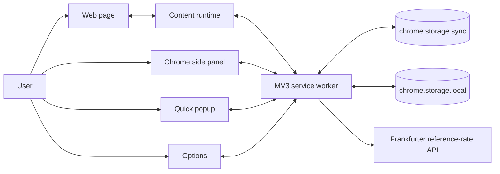
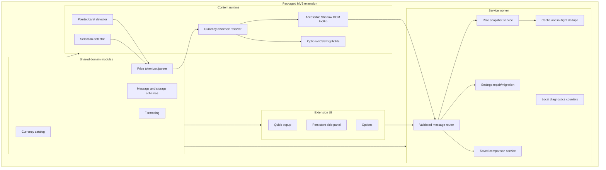
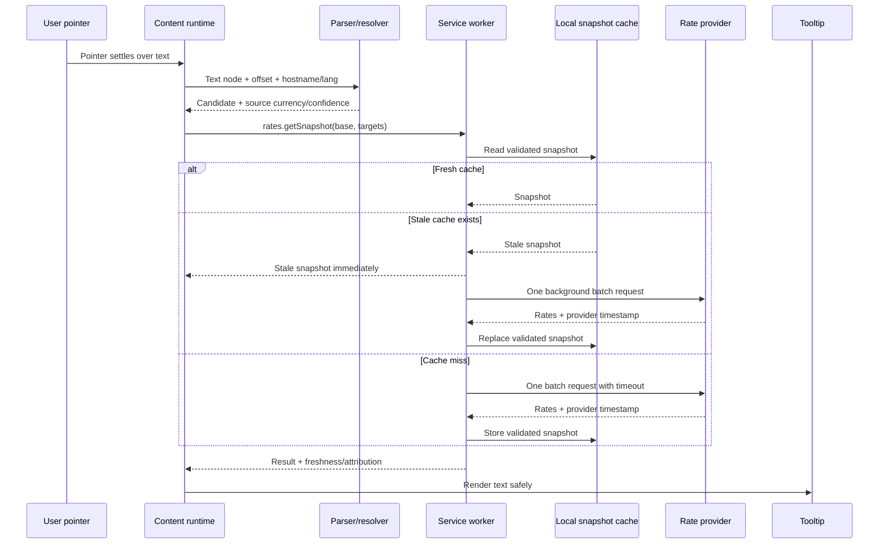
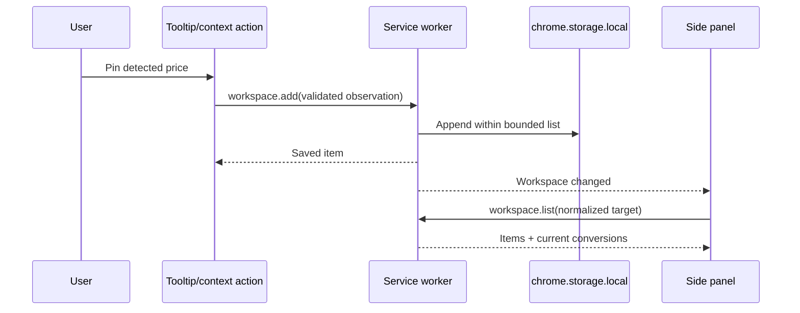
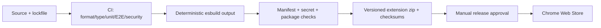

# Forex Hover Pro — Architecture

Status: approved for v3; implementation is in progress.  
Decision authority: approved by the user on 2026-09-21.

## System goal

Evolve Forex Hover Pro from a transient hover converter into a local-first currency intelligence workspace while preserving its core interaction. The target system should detect prices accurately, avoid mutating host-page DOM, return cached conversions immediately, explain ambiguous currencies, and let a user keep a small cross-tab comparison workspace.

## Architectural principles

1. Local-first and no account by default.
2. Page content never leaves the tab; only validated currency codes reach the rate provider.
3. One rate snapshot per base, not one request per currency pair.
4. Native browser capabilities before frameworks or services.
5. No host-page DOM replacement for hover behavior.
6. Shared contracts and one currency catalog.
7. Every external boundary validates input before storage, calculation, or rendering.
8. Historical/reference rates are labeled accurately; this is not a trading terminal.

## Target context diagram



## Target component model



## Component responsibilities

### Shared domain modules

#### Currency catalog

One versioned source for ISO code, display name, common symbols/aliases, flag/region label, and supported fraction digits. UI lists, parsing, validation, and formatting consume this source. Provider coverage is fetched/cached separately because it can change independently.

#### Price parser

A pure module that turns text into zero or more candidates:

```text
{ raw, amount, currencyEvidence[], range, confidence, warnings[] }
```

It recognizes prefix/suffix ISO codes, single- and multi-character symbols, common grouping conventions, apostrophes/spaces, negative/zero policy, and currency-specific fraction digits. It does not inspect the DOM or call an API.

#### Currency resolver

Resolves ambiguous evidence in this order:

1. Explicit ISO code in the price.
2. Exact user domain override.
3. Longest matching parent-domain override.
4. Unambiguous symbol.
5. Page language/region and top-level-domain hints.
6. User default source-currency preference.
7. Mark ambiguous and ask/show the assumption instead of silently claiming certainty.

Every resolution can expose “why this currency” in the tooltip or side panel.

#### Contracts

Defines a small discriminated message union and storage record schemas. Example message families:

- `rates.getSnapshot`
- `settings.get` / `settings.update`
- `workspace.add` / `workspace.list` / `workspace.remove`
- `diagnostics.get` / `diagnostics.clear`

The service worker rejects unknown message types, invalid ISO codes, non-finite amounts, excessive target lists, and oversized records.

### Content runtime

#### Pointer/caret detection

The default hover path listens to pointer movement, limits work to one animation-frame callback, asks the document for the text position at the pointer, parses only the containing text node, and checks whether the pointer offset is inside a price candidate. It does not pre-scan or rewrite the page.

Use standard `caretPositionFromPoint()` when available and Chromium's `caretRangeFromPoint()` fallback. A small dwell delay prevents tooltip flicker.

#### Selection detection

When enabled, parses the selected text after the selection settles. It uses the same parser/resolver as hover and can surface multiple candidates in the side panel rather than silently picking the first when more than one price is selected.

#### Optional underlines

When enabled, an idle-budgeted TreeWalker builds `Range` objects and registers a CSS Custom Highlight. Dynamic updates process only affected text nodes/subtrees. Underlines are visual only; hover detection remains pointer-driven. When the API is unavailable, the setting degrades to hover-only instead of wrapping DOM nodes.

#### Tooltip

Remains inside Shadow DOM, but variable content is created with DOM methods/text nodes. It shows:

- original amount and resolved currency;
- one or more converted amounts;
- freshness and provider attribution;
- ambiguity/assumption when applicable;
- stale/offline state;
- keyboard-accessible “pin to workspace” action when interactive mode is invoked.

### MV3 service worker

#### Validated message router

The only privileged entry point. It validates every message and returns a stable success/error envelope. No caller can supply a URL; the rate endpoint is fixed in packaged code.

#### Rate snapshot service

For one base currency and a bounded target set:

1. Read the last validated snapshot from local storage.
2. If fresh, return it.
3. If stale but usable, return it immediately with `stale: true` and refresh in the background.
4. Coalesce simultaneous refreshes by base currency.
5. Fetch one batched provider response.
6. Apply timeout, HTTP check, JSON/schema validation, finite-positive-rate validation, and provider timestamp validation.
7. Atomically replace the snapshot only when the complete response is valid.

The first provider is Frankfurter v2 because it is keyless, batch-capable, historical, and open/self-hostable. Do not add a provider abstraction hierarchy until a second provider is actually required; keep the provider-specific fetch in one module boundary.

#### Settings service

Reads sync storage, migrates legacy `targetCurrency`, repairs invalid values, caps selected targets, and writes a schema version. Content/UI contexts receive the same sanitized settings object.

#### Workspace service

Stores a bounded local list of pinned observations:

```text
{ id, capturedAt, sourceDomain, originalAmount, sourceCurrency,
  normalizedCurrency, normalizedAmount, rateTimestamp, title? }
```

Full URLs and page text are not stored by default. The list has an explicit size cap and user-controlled clear/export actions.

#### Diagnostics

Keeps bounded counters/timings locally: cache hit/miss, provider latency bucket, provider errors, parser candidate count, and last failure category. It does not collect page text, URLs, or identifiers and is never transmitted automatically.

### Extension UI

#### Quick popup

Small, fast surface for enable/pause, current-site status, target summary, quick amount conversion, and opening the side panel. It must not perform a provider health request merely by opening.

#### Side panel

Persistent workspace for:

- manual conversion;
- pinned cross-tab comparisons normalized to one target;
- recent conversions;
- 30/90-day reference-rate context on demand;
- freshness/provider/offline state;
- current-site currency assumption and override shortcut.

#### Options

Focused settings only: target currencies, source-currency assumptions/domain overrides, hover/selection/underline behavior, data/privacy controls, and diagnostics/export/reset. Product story and setup prose move to README/store documentation.

## Data flows

### Hover conversion



### Pin and compare



### Settings change

Options writes through the service worker. The worker validates, persists one schema-versioned object, and broadcasts the sanitized result. Content scripts update listeners/highlights without a full page reload when safe; permission changes use Chrome's permission flow.

## Storage design

| Store | Data | Why |
|---|---|---|
| `chrome.storage.sync` | Small preferences and domain overrides | Cross-device preference sync; must remain under documented quotas |
| `chrome.storage.local` | Validated rate snapshots, workspace items, local diagnostics, migration backup | Local volume is sufficient; no `unlimitedStorage` required |
| Service-worker memory | In-flight fetch promises and hot snapshot references | Performance only; correctness never depends on survival |
| External database | None | No validated need |

Records include `schemaVersion`; migrations are pure functions tested against old and corrupt fixtures.

## Authentication and authorization

There is no application account and no remote user-owned resource, so authentication would add risk without value. Authorization is instead capability-based:

- Chrome permissions govern page access.
- Content scripts can request only allowlisted message operations.
- The worker never accepts arbitrary fetch URLs.
- Site access is user-controlled and can be optional/per-site.

If a future cloud-sync product is approved, it requires a separate architecture decision, threat model, and data-retention policy.

## Security model

- No secret is shipped in source, sync storage, logs, or URLs.
- Page text stays in the content script.
- Provider responses and storage are untrusted until validated.
- Variable UI content uses `textContent`/DOM nodes, not interpolated HTML.
- Targets and message sizes are bounded.
- Network calls use HTTPS, fixed origins, abort timeouts, and no redirects to arbitrary hosts.
- Required permissions are reviewed per release; optional host permissions are preferred where product behavior allows.
- Remote scripts, styles, and fonts are absent from the extension package.
- A privacy statement documents local processing, rate requests, saved-item fields, and deletion controls.

## Reliability and failure recovery

| Failure | Response | Recovery |
|---|---|---|
| Provider timeout/5xx | Show validated stale snapshot with timestamp; otherwise concise unavailable state | Next user request retries after backoff |
| Malformed provider payload | Reject entire new snapshot | Keep prior good snapshot and increment diagnostic counter |
| Worker termination | In-flight work may fail once | Caller retries once; persistent cache/settings survive |
| Corrupt settings | Repair to defaults/allowlist | Persist repaired schema and surface one non-blocking notice |
| Storage quota/write failure | Keep in-memory result, notify diagnostics | Bound/evict oldest workspace and cache records |
| Unsupported/restricted page | Popup explains page access state | User can grant access or use manual converter |
| Ambiguous symbol | Display assumption/confidence; do not hide uncertainty | User sets one-time or domain override |

## Scaling strategy

The workload scales horizontally across users because computation and storage live in each browser. Provider pressure is controlled by one request per base snapshot, long-lived validated caching, request coalescing, and a bounded target list. There is no central database or queue to scale.

Add a thin managed rate gateway only if measured store-scale usage, provider terms, or an SLA requires it. That gateway would own provider secrets, shared caching, rate limiting, and aggregate health metrics; it would not receive page text or browsing history. This is a future decision, not part of target v3.

## Deployment architecture



The first release remains manual after CI produces a verified artifact. Automated store upload is added only after releases are frequent enough to justify credentialed release automation.

## Target quality attributes

- Parser fixture precision at least 98% and recall at least 95% on the agreed corpus.
- Cached hover conversion visible in under 100 ms at p95 on the benchmark pages.
- No extension-attributable main-thread task over 50 ms in default hover mode.
- One provider request per base refresh, independent of target count.
- At least 90% cache hit rate in the repeated-browsing benchmark.
- Stale conversion remains available for up to seven days with explicit age labeling.
- Zero uncaught console errors across the E2E suite.
- WCAG 2.2 AA contrast, names, focus order, keyboard operation, and reduced motion for extension UI.
- Release package contains no secret and no remote executable/styling dependency.
