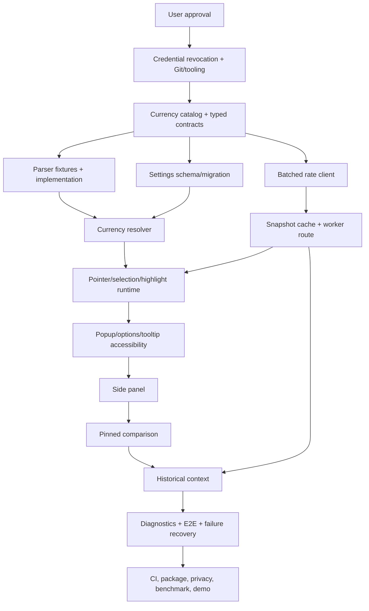

# Forex Hover Pro v3 — Implementation Plan

Status: **Implementation in progress.**  
Canonical architecture: [ARCHITECTURE.md](ARCHITECTURE.md)  
Operational checklist mirror: [tasks/todo.md](tasks/todo.md)

Status legend:

- `[ ]` Not Started
- `[~]` In Progress
- `[x]` Completed and validated
- `[!]` Blocked

## Objective

Deliver a production-oriented, local-first Chrome extension that preserves instant contextual conversion while making detection accurate, page integration non-invasive, rate access efficient/resilient, permissions trustworthy, and the product useful as a persistent comparison workspace.

## Scope contract

Included:

- Correct locale/symbol parsing and currency resolution.
- One batched, validated, stale-aware rate snapshot per base.
- Pointer/selection detection and optional native highlights.
- Accessible popup, options, tooltip, and Chrome side panel.
- Local pinned-price comparisons and on-demand historical reference context.
- Tests, diagnostics, CI/package pipeline, privacy/release documentation.

Excluded unless separately approved:

- AI/ML, cryptocurrency, trading signals, accounts, cloud database, microservices, external analytics, large-scale scraping, OCR, and automated store publishing.

## Dependency graph

## Milestone 0 — Audit, decision, and safety gate

### [x] M0-T1: Audit the current repository

**Objective:** Establish evidence for current behavior, architecture, risks, and strengths.

**Affected files/components:** All current source files; `PROJECT_AUDIT.md`.

**Dependencies:** None.

**Implementation:** Read every text source file, render popup/options in an isolated browser fallback, run JavaScript syntax checks, execute representative detector fixtures, inventory permissions/settings/catalogs, and record findings by severity.

**Expected result:** A traceable baseline that distinguishes working core behavior from claims and dead settings.

**Validation:** Six JavaScript files passed `node --check`; detector baseline recorded as 6/16 representative fixtures; line/permission/catalog counts recorded.

**Completion criteria:** Audit document links each major recommendation to observed code or a primary source. Completed 2026-09-21.

### [x] M0-T2: Research the current platform and product landscape

**Objective:** Verify proposed architecture against current Chrome, web-platform, rate-provider, and competitor capabilities.

**Affected files/components:** `RESEARCH.md`, `TECH_STACK.md`, `DECISIONS.md`.

**Dependencies:** M0-T1.

**Implementation:** Review official Chrome MV3/storage/permission/CSP/side-panel/testing documentation, current web APIs for caret/highlights, current provider APIs, and comparable extension/store/repository offerings.

**Expected result:** Evidence-backed decisions and explicit rejection of buzzword-driven infrastructure.

**Validation:** Every non-trivial platform/provider claim has a direct primary-source link; competitor claims link to store/upstream pages.

**Completion criteria:** Target architecture and stack are technically feasible with stated trade-offs. Completed 2026-09-21.

### [x] M0-T3: Approve or revise the v3 proposal

**Objective:** Freeze product scope, architecture, and milestone order before application code changes.

**Affected files/components:** `ARCHITECTURE.md`, `FEATURES.md`, `TECH_STACK.md`, `DECISIONS.md`, this plan.

**Dependencies:** M0-T1, M0-T2.

**Implementation:** User reviews the proposal, identifies changes, and explicitly approves execution. Accepted decisions change from Proposed to Accepted.

**Expected result:** One agreed target and no hidden architecture assumptions.

**Validation:** Explicit user approval in the task conversation; open questions resolved or deliberately deferred.

**Completion criteria:** Approval recorded and M1-T1 may start.

### [!] M0-T4: Revoke the exposed ExchangeRate-API credential

**Objective:** Make the credential currently visible in `background.js` unusable.

**Affected files/components:** External ExchangeRate-API account; later source/history cleanup in M1-T1/M3-T4.

**Dependencies:** Credential owner access. This action is safe to do before implementation approval.

**Implementation:** User revokes/regenerates the exposed key in the provider dashboard. Do not paste the replacement into source or chat.

**Expected result:** The disclosed key can no longer consume quota.

**Validation:** Provider dashboard shows the old key revoked; a request with the old key fails if the owner chooses to verify privately.

**Completion criteria:** User confirms revocation. Source removal alone does not complete this task.

### Milestone 0 checkpoint

- [x] Audit and research documents are complete.
- [ ] User has approved/revised the proposal.
- [ ] Exposed credential is revoked.
- [ ] No application code has changed before approval.

## Milestone 1 — Repository and verification foundation

### [x] M1-T1: Initialize version control and secret-safe ignores

**Objective:** Create a recoverable history before implementation.

**Affected files/components:** `.git/`, `.gitignore`, current source snapshot.

**Dependencies:** M0-T3; M0-T4 for a safe initial public history.

**Implementation:** Initialize Git, add ignores for dependencies/build output/environment/keys/test artifacts, scan the tree for credential patterns, remove the exposed credential from the working source, and create an atomic baseline commit only after review.

**Expected result:** A clean repository with no committed secret and a reversible baseline.

**Validation:** `git status` clean after commit; secret scan clean; ignored files behave as intended; current syntax check still passes.

**Completion criteria:** Baseline commit exists and does not contain a live credential.

### [ ] M1-T2: Add the minimum TypeScript/build/test toolchain

**Objective:** Establish repeatable local commands without changing runtime behavior.

**Affected files/components:** `package.json`, lockfile, `tsconfig.json`, `scripts/build.mjs`, `.gitignore`.

**Dependencies:** M1-T1.

**Implementation:** Pin the package manager; add TypeScript, esbuild, Chrome types, and scripts for clean build/type/unit/package. Block dependency install scripts by default where supported; review lockfile and licenses.

**Expected result:** Current entry points can be reproduced into `dist/` and checked consistently.

**Validation:** Clean frozen install, `npm run typecheck`, `npm test`, and `npm run build` succeed; generated output is ignored and loadable.

**Completion criteria:** Commands and required runtime versions are documented in README; no UI/framework dependency is added.

### [ ] M1-T3: Capture executable regression fixtures for current behavior

**Objective:** Turn audit evidence into tests before refactoring.

**Affected files/components:** `tests/detector.baseline.test.*`, `tests/fixtures/prices.*`, `priceDetector.js` test export/loading shim if necessary.

**Dependencies:** M1-T2.

**Implementation:** Encode passing and failing price examples, false-positive prose, long amounts, suffix codes/symbols, Indian/European/US grouping, multi-character symbols, negatives, and zero policy. Mark known failures explicitly rather than making the baseline suite green by weakening assertions.

**Expected result:** The parser's intended contract is reviewable and every current critical failure is reproducible.

**Validation:** Test command reports known expected failures or a separate audit fixture report deterministically; syntax/build stay green.

**Completion criteria:** No parser rewrite begins without a corpus that would catch current regressions.

### [ ] M1-T4: Add extension-load smoke tests

**Objective:** Detect CSP, missing-resource, and startup regressions in a real clean Chrome profile.

**Affected files/components:** `tests/e2e/extension-smoke.test.*`, deterministic test page, E2E launcher helper, package scripts.

**Dependencies:** M1-T2.

**Implementation:** Add Puppeteer, load the built unpacked extension, find the service worker, open popup/options, collect console errors, and verify core elements render.

**Expected result:** One command proves the packaged extension starts in Chrome rather than merely parsing in Node.

**Validation:** Clean-profile smoke test passes with zero uncaught console errors; test fails when an inline script/CSP or missing-entry error is introduced.

**Completion criteria:** Build plus smoke test is the standing checkpoint for later tasks.

### Milestone 1 checkpoint

- [ ] Review changes with `REVIEW_CHECKLIST.md`.
- [ ] Frozen install, type check, baseline fixtures, build, and smoke E2E run.
- [ ] No live secret in source, artifacts, or Git history created by this repository.
- [ ] Current user-visible behavior is otherwise unchanged.

## Milestone 2 — Domain model, parser, and settings correctness

### [ ] M2-T1: Create the canonical currency catalog

**Objective:** Replace four drifting lists with one source of truth.

**Affected files/components:** `src/shared/currencies.ts`, `src/shared/format.ts`, `tests/currencies.test.ts`, build entry imports.

**Dependencies:** M1 checkpoint.

**Implementation:** Define supported ISO codes, names, symbol aliases, labels/flags, and provider mapping. Format with `Intl.NumberFormat`; test zero-, two-, and three-fraction currencies. Do not manually duplicate catalogs in UI files.

**Expected result:** Parser, validation, tooltip, popup, side panel, and options can consume the same catalog.

**Validation:** Catalog uniqueness/ISO format/alias collision tests pass; KWD/BHD and JPY/KRW formatting fixtures pass.

**Completion criteria:** All newly migrated code imports the catalog; legacy copies are removed only as their consumers migrate.

### [ ] M2-T2: Define typed message and storage contracts

**Objective:** Make cross-context and persisted boundaries explicit.

**Affected files/components:** `src/shared/contracts.ts`, `src/shared/validate.ts`, `tests/contracts.test.ts`.

**Dependencies:** M2-T1.

**Implementation:** Define discriminated message/result types and small explicit runtime guards for codes, amounts, targets, rate snapshots, settings, workspace records, and error envelopes. Cap collection/string sizes.

**Expected result:** Invalid callers/storage/provider data cannot enter privileged logic or UI rendering.

**Validation:** Valid, unknown-type, malformed, oversized, non-finite, and unsupported-code fixtures pass.

**Completion criteria:** The service-worker migration can route only validated contracts.

### [ ] M2-T3: Replace the master regex with a tokenizer/parser

**Objective:** Correct the core product behavior across agreed price formats.

**Affected files/components:** `src/shared/price-parser.ts`, `tests/price-parser.test.ts`, `tests/fixtures/prices.*`; legacy `priceDetector.js` removed only after consumer migration.

**Dependencies:** M1-T3, M2-T1, M2-T2.

**Implementation:** Parse currency evidence before/after amounts; normalize Unicode spaces/minus; support common grouping/decimal conventions and multi-character symbols; reject partial/truncated matches; return candidate ranges/evidence rather than resolving ambiguous symbols.

**Expected result:** Pure deterministic candidates suitable for hover, selection, and fixtures.

**Validation:** Agreed corpus reaches ≥98% precision and ≥95% recall; every current critical fixture passes; fuzz/invariant checks prove no partial four-digit truncation and no NaN/Infinity output.

**Completion criteria:** Parser contract and limitations are documented; no DOM/provider dependency exists.

### [ ] M2-T4: Implement currency evidence resolution and domain overrides

**Objective:** Resolve ambiguous symbols consistently and transparently.

**Affected files/components:** `src/shared/currency-resolver.ts`, `tests/currency-resolver.test.ts`, settings contract/catalog.

**Dependencies:** M2-T1, M2-T3.

**Implementation:** Apply explicit ISO, exact/longest domain override, symbol uniqueness, document language/region, hostname/TLD hint, and user default in a documented order. Return confidence and explanation; never silently label weak evidence as certain.

**Expected result:** `$`/`¥` ambiguity becomes controllable and explainable.

**Validation:** Resolver precedence, subdomain matching, public-suffix edge examples, invalid domains, and fallback fixtures pass.

**Completion criteria:** Existing domain-rule UI can be wired to a tested runtime consumer.

### [ ] M2-T5: Add settings schema, repair, and migration

**Objective:** Make preferences safe across fresh install, upgrade, sync corruption, and partial writes.

**Affected files/components:** `src/shared/settings.ts`, `tests/settings.test.ts`, legacy preference read/write paths.

**Dependencies:** M2-T1, M2-T2.

**Implementation:** Define defaults and schema version; migrate legacy `targetCurrency`; allowlist/cap targets; normalize domain overrides; repair booleans and unknown fields; keep sync payload under quota.

**Expected result:** Every context receives the same valid settings object.

**Validation:** Fresh, legacy, corrupt, oversized, and future-unknown fixture tests pass; repaired values are stable on a second read.

**Completion criteria:** No consumer reads raw sync storage directly after its migration task.

### Milestone 2 checkpoint

- [ ] Parser/resolver/settings tests pass and meet target metrics.
- [ ] Shared contracts/currency catalog have no duplicate consumer copy in migrated paths.
- [ ] Security review confirms all new boundaries are validated.
- [ ] Existing build/smoke E2E stays green.

## Milestone 3 — Efficient and resilient rate path

### [ ] M3-T1: Implement one batched, validated rate request

**Objective:** Replace pair fan-out and the packaged credential.

**Affected files/components:** `src/background/rate-client.ts`, `tests/rate-client.test.ts`, manifest provider host permission, provider fixtures.

**Dependencies:** M2-T1, M2-T2; M0-T4.

**Implementation:** Call Frankfurter v2 once per base/target set using a fixed HTTPS origin; apply `AbortController` timeout; validate status/content/size/schema/timestamp/finite positive rates; map errors to stable categories.

**Expected result:** One credential-free network request supplies all tooltip targets.

**Validation:** Mocked success, timeout, abort, 4xx, 5xx, invalid JSON, missing target, invalid rate, and oversized/partial payload tests pass.

**Completion criteria:** No live/shared API key or pair-request loop remains in the migrated rate path.

### [ ] M3-T2: Build the snapshot cache and in-flight deduplication

**Objective:** Return fast, fresh-enough results and survive provider outages.

**Affected files/components:** `src/background/rate-cache.ts`, `tests/rate-cache.test.ts`, storage contracts.

**Dependencies:** M3-T1, M2-T5.

**Implementation:** Cache validated snapshots per base; distinguish fresh/stale/expired; return stale while refreshing; coalesce concurrent refresh promises; atomically retain last-good data; bound snapshot count.

**Expected result:** Repeated hovers avoid network work and offline users see labeled stale data.

**Validation:** Fake-clock tests cover fresh hit, stale hit/refresh, hard expiry, concurrent callers (one fetch), failed refresh retention, storage corruption, and eviction.

**Completion criteria:** Cache behavior does not depend on service-worker globals surviving.

### [ ] M3-T3: Migrate worker messages and all current conversion consumers

**Objective:** Deliver the new rate path as a complete vertical slice.

**Affected files/components:** `src/background/index.ts`, content rate caller, popup converter caller, `manifest.json`, E2E tests.

**Dependencies:** M2-T2, M3-T2.

**Implementation:** Route `rates.getSnapshot`, reject old/unknown messages after callers migrate, propagate freshness/provider data, render stale/error states, and remove legacy `GET_RATE`/`GET_RATES_MULTI` code.

**Expected result:** Hover/selection/manual conversion share one contract and cache.

**Validation:** Unit contracts plus E2E cached/uncached/manual flows; network instrumentation confirms one request for multiple targets.

**Completion criteria:** No current UI calls the old message types; build has no hardcoded provider credential.

### [ ] M3-T4: Harden CSP, rendering, and permissions

**Objective:** Remove known store/security blockers before feature expansion.

**Affected files/components:** `manifest.json`, `tooltip` renderer, `options.html/js`, `popup.html`, packaged assets.

**Dependencies:** M3-T3, M2-T5.

**Implementation:** Remove inline script and duplicate handler; remove remote fonts or package approved local assets; replace variable `innerHTML`; remove `tabs` and `unlimitedStorage`; remove `contextMenus` until implemented; document remaining page/provider access.

**Expected result:** Self-contained extension pages, minimum permissions, and safe variable rendering.

**Validation:** Clean-profile E2E reports zero CSP/console errors; static scan finds no remote code/style URL or untrusted interpolation; permission inventory maps each permission to a test.

**Completion criteria:** Chrome loads the packaged extension without policy-relevant warnings introduced by the project.

### Milestone 3 checkpoint

- [ ] Multi-target conversion uses one provider request per base refresh.
- [ ] Cached/stale/error states pass unit and E2E tests.
- [ ] No secret, remote extension asset, unnecessary named permission, or unsafe variable HTML remains in migrated surfaces.
- [ ] Milestone security/reliability review completed.

## Milestone 4 — Non-invasive page runtime

### [ ] M4-T1: Implement pointer/caret hover detection

**Objective:** Preserve hover conversion without startup scanning or text-node replacement.

**Affected files/components:** `src/content/pointer-detector.ts`, `src/content/index.ts`, deterministic test pages, content E2E tests.

**Dependencies:** M2-T3, M2-T4, M3-T3.

**Implementation:** Throttle pointer work to animation frames; resolve text node/offset with standard API and Chromium fallback; skip editable/code/extension surfaces; detect candidate under offset; use dwell/cancellation to prevent stale tooltip races.

**Expected result:** Hover works on static/dynamic text while host DOM remains unchanged.

**Validation:** E2E covers nested markup, long amounts, rapid pointer movement, restricted elements, scroll/reposition, and asserts original page DOM/text-node identity where practical.

**Completion criteria:** Default mode performs no initial full-page scan and creates no price wrapper spans.

### [ ] M4-T2: Rebuild selection behavior on shared parser/settings

**Objective:** Make text-selection conversion correct, optional, and multi-candidate aware.

**Affected files/components:** `src/content/selection-detector.ts`, content orchestrator, settings listener, E2E tests.

**Dependencies:** M2-T5, M4-T1.

**Implementation:** Attach/remove named listeners based on settings; parse settled selection; handle no/one/multiple candidates; cancel on new selection/navigation/context loss; avoid duplicate listeners.

**Expected result:** The selection toggle changes behavior immediately and multiple selected prices are not silently collapsed.

**Validation:** E2E toggles selection on/off repeatedly, verifies listener behavior and single tooltip/panel result, and covers multi-price selection.

**Completion criteria:** No anonymous unrecoverable listener or legacy selection path remains.

### [ ] M4-T3: Add optional non-invasive underlines

**Objective:** Make the existing underline setting real without restoring DOM wrappers.

**Affected files/components:** `src/content/highlights.ts`, content CSS entry, settings listener, highlight E2E/benchmark fixtures.

**Dependencies:** M4-T1, M2-T5.

**Implementation:** Scan in idle/time-budgeted chunks only when enabled; register `Range`s with CSS Custom Highlight; observe relevant element/text changes; bound work/range count; clear cleanly; fall back to hover-only when unsupported.

**Expected result:** Visible annotations do not alter page markup or attach per-price listeners.

**Validation:** E2E verifies on/off/dynamic updates and no wrapper spans; performance test checks task budget on large fixture.

**Completion criteria:** Underline setting is truthful and page DOM is preserved.

### [ ] M4-T4: Establish page-runtime performance baselines and gates

**Objective:** Quantify the benefit and prevent regressions.

**Affected files/components:** `tests/performance/*`, benchmark fixture pages, `docs/benchmarks.md`, package scripts.

**Dependencies:** M4-T1, M4-T3.

**Implementation:** Measure startup script time, long tasks, cached tooltip latency, highlight scan duration, mutation update cost, and memory/range count on representative small/large/dynamic pages.

**Expected result:** Reproducible baseline-vs-v3 evidence.

**Validation:** Default hover mode has no extension-attributable task >50 ms; cached tooltip p95 <100 ms on agreed environment; results record machine/Chrome/method.

**Completion criteria:** CI can run deterministic regression thresholds; environment-sensitive metrics are reported rather than made flaky blockers.

### Milestone 4 checkpoint

- [ ] Hover, selection, and underline settings work end-to-end.
- [ ] No host text-node replacement remains.
- [ ] Performance targets are met or the plan records evidence-backed remediation.
- [ ] Architecture/security/accessibility review completed before UI expansion.

## Milestone 5 — Accessible, coherent extension UI

### [ ] M5-T1: Establish shared UI tokens and accessibility behavior

**Objective:** Unify branding and interaction basics without creating a component framework.

**Affected files/components:** shared CSS tokens, packaged icon assets, UI accessibility helper if needed, UI test assertions.

**Dependencies:** M3-T4, M4 checkpoint.

**Implementation:** Define colors/type/spacing/focus/motion tokens; choose system or packaged fonts; align icon/name; add `prefers-reduced-motion`; specify live-region and focus rules.

**Expected result:** Popup/options/tooltip/side panel can share a small visual/interaction language.

**Validation:** Contrast audit, keyboard focus-visible check, reduced-motion screenshot/test, correct product branding.

**Completion criteria:** Tokens are reused by at least two surfaces; no design-system abstraction beyond actual reuse.

### [ ] M5-T2: Refactor the tooltip for accessible states and actions

**Objective:** Communicate conversions, ambiguity, freshness, errors, and pin action clearly.

**Affected files/components:** `src/content/tooltip.ts`, tooltip CSS, E2E accessibility tests.

**Dependencies:** M5-T1, M3-T3, M4-T1.

**Implementation:** Use safe DOM construction; add status semantics; show source assumption/confidence and stale/provider timestamp; support passive hover plus an explicit keyboard/click interactive mode for pinning.

**Expected result:** Tooltip remains unobtrusive but no longer hides important uncertainty or freshness.

**Validation:** Keyboard/accessibility-tree checks, error/stale/ambiguous screenshots, rapid request race test.

**Completion criteria:** All tooltip states are named, safe, and covered by E2E.

### [ ] M5-T3: Simplify and correct the popup

**Objective:** Make the popup a reliable quick-control surface.

**Affected files/components:** popup HTML/CSS/TS entry, popup E2E tests.

**Dependencies:** M5-T1, M3-T3, M2-T5.

**Implementation:** Show real current-page/access/enabled state; label inputs/selects; preserve manual converter; remove automatic health request; add open-side-panel action placeholder; bound/scroll content; add live result/error feedback.

**Expected result:** Popup opens fast, tells the truth, and supports keyboard/manual conversion.

**Validation:** Clean-profile popup E2E covers restricted page, enabled state, invalid amount, conversion, swap, and error; no network call occurs merely on open.

**Completion criteria:** Popup meets agreed accessibility and console-clean checks.

### [ ] M5-T4: Simplify and wire the options page

**Objective:** Turn settings from a marketing page into a truthful configuration surface.

**Affected files/components:** options HTML/CSS/TS entry, settings service, options E2E tests.

**Dependencies:** M5-T1, M2-T4, M2-T5, M3-T4.

**Implementation:** Keep targets, domain rules, hover/selection/underline, data controls, and diagnostics link; validate domain input inline; provide responsive navigation; announce save state; remove false key/setup/lifecycle claims and duplicated product prose.

**Expected result:** Every visible control has an immediate tested runtime effect.

**Validation:** E2E changes each setting and observes sanitized storage plus content behavior; keyboard/responsive checks pass.

**Completion criteria:** No saved-but-unused option remains.

### [ ] M5-T5: Add the native side-panel shell and recent conversions

**Objective:** Create the persistent home for expanded functionality.

**Affected files/components:** `sidepanel.html`, side-panel CSS/TS entry, manifest side-panel config/permission, E2E tests.

**Dependencies:** M5-T1, M5-T3, M3-T3.

**Implementation:** Configure Chrome Side Panel API; open from explicit user action; reuse manual converter contract; persist bounded recent conversions locally; handle tab changes and narrow/wide panel sizes.

**Expected result:** Manual conversion/history survives popup closure and remains alongside browsing.

**Validation:** E2E opens, closes, reopens, switches tabs, converts, and verifies persisted bounded history with clean console.

**Completion criteria:** Side panel is usable before comparison/history features are layered in.

### Milestone 5 checkpoint

- [ ] Popup, tooltip, options, and side panel pass keyboard/accessibility/contrast/reduced-motion review.
- [ ] Every control maps to tested behavior.
- [ ] No remote asset or CSP error exists.
- [ ] UI screenshots captured for review before workspace expansion.

## Milestone 6 — Currency intelligence workspace

### [ ] M6-T1: Add bounded local pinned-price storage and messages

**Objective:** Persist user-chosen observations without collecting unnecessary browsing data.

**Affected files/components:** `src/background/workspace.ts`, shared workspace contract, `tests/workspace.test.ts`, worker router.

**Dependencies:** M2-T2, M3-T3, M5-T5.

**Implementation:** Add/list/remove/clear/export bounded observations; store domain (not full URL) and optional user-approved title; deduplicate IDs; evict oldest beyond cap; document fields/purpose.

**Expected result:** Safe local foundation for cross-tab comparison.

**Validation:** Boundary, corruption, duplicate, eviction, export, clear, and storage-failure tests pass.

**Completion criteria:** Workspace data has an explicit cap, schema, and deletion/export path.

### [ ] M6-T2: Implement pin-and-compare flow

**Objective:** Let users compare detected prices from multiple pages in one normalized currency.

**Affected files/components:** tooltip action, side-panel comparison view, workspace messages, E2E tests.

**Dependencies:** M5-T2, M6-T1, M3-T3.

**Implementation:** Pin validated candidate with current snapshot metadata; show original/normalized value, domain, capture time, freshness, and remove/clear; let user choose normalization target; recompute from current validated snapshot without overwriting capture evidence.

**Expected result:** A coherent cross-tab shopping/travel comparison workflow.

**Validation:** E2E pins from two test tabs/currencies, normalizes, changes target, removes/clears, restarts panel, and verifies local-only record shape.

**Completion criteria:** Demo comparison flow is complete and no page text/full URL is stored by default.

### [ ] M6-T3: Add on-demand historical rate context

**Objective:** Explain whether a conversion rate is high/low relative to recent reference history.

**Affected files/components:** `src/background/history-client.ts`, history cache/tests, side-panel rate-context view.

**Dependencies:** M3-T1, M3-T2, M6-T2.

**Implementation:** Fetch bounded 30/90-day series only on user request; validate/cache it; calculate change/min/max locally; render a simple accessible SVG/sparkline and text summary; state provider/reference-rate limitations.

**Expected result:** Useful context without turning the product into a trading tool.

**Validation:** Series validation/aggregation tests; E2E success/stale/error/empty paths; no chart library added.

**Completion criteria:** Historical context is accurate, labeled, cached, and optional.

### [ ] M6-T4: Add context-menu conversion only if permission trade-off is accepted

**Objective:** Provide an explicit accessible fallback for selected text and a side-panel entry point.

**Affected files/components:** manifest permission, worker context-menu registration, selection handoff, E2E tests.

**Dependencies:** M5-T5, M6-T2; explicit confirmation during milestone review.

**Implementation:** Add one selection-only menu item, register on install idempotently, validate selection text through the shared parser, and open the side panel after the user action.

**Expected result:** Keyboard/context-menu users can convert and pin without hover.

**Validation:** E2E verifies menu registration/action and permission rationale; no menu appears in irrelevant contexts.

**Completion criteria:** `contextMenus` is present only if this feature ships. Otherwise close task as intentionally rejected and leave permission absent.

### Milestone 6 checkpoint

- [ ] Cross-tab comparison and history context solve the approved user stories.
- [ ] Workspace data is local, bounded, exportable, and erasable.
- [ ] Context-menu permission decision is explicit.
- [ ] Product remains currency decision support, not budgeting/trading scope.

## Milestone 7 — Reliability, diagnostics, and complete verification

### [ ] M7-T1: Add privacy-preserving local diagnostics

**Objective:** Make performance and failures inspectable without transmitting browsing data.

**Affected files/components:** `src/background/diagnostics.ts`, tests, options/side-panel diagnostics view, contracts.

**Dependencies:** M3-T2, M5-T4, M5-T5.

**Implementation:** Record bounded counters/timing buckets/error categories; exclude URLs, page text, amounts, identifiers; add view/export/clear; gate verbose console logs behind debug setting.

**Expected result:** Users/developers can diagnose cache/provider/runtime behavior locally.

**Validation:** Privacy-field allowlist test, cap/rotation test, export/clear E2E, and no default outbound telemetry request.

**Completion criteria:** Diagnostics answers agreed operational questions without sensitive payloads.

### [ ] M7-T2: Complete failure recovery and race handling

**Objective:** Make adverse conditions predictable across content, worker, provider, and storage boundaries.

**Affected files/components:** rate/cache/router/content orchestration modules and focused tests.

**Dependencies:** M4-T2, M6-T3, M7-T1.

**Implementation:** Add bounded retry/backoff where safe, latest-request wins/cancellation, worker restart retry, storage-write fallback, stale labeling, and consistent user-facing error categories.

**Expected result:** No stuck spinner, stale race overwrite, or loss of last-good data.

**Validation:** Deterministic failure-injection tests for timeout, rapid hover, worker restart, storage rejection, corrupt data, and provider recovery.

**Completion criteria:** Failure matrix in `ARCHITECTURE.md` is covered or explicitly deferred.

### [ ] M7-T3: Expand end-to-end coverage to release-critical journeys

**Objective:** Protect the real extension package across contexts.

**Affected files/components:** `tests/e2e/*`, deterministic fixtures/mocks, test scripts.

**Dependencies:** M5 checkpoint, M6 checkpoint, M7-T2.

**Implementation:** Cover install/defaults, hover cached/uncached, ambiguity override, selection on/off, underline dynamic update, popup manual conversion, side-panel persistence, pin/compare/history, offline stale fallback, permission denial, and upgrade migration.

**Expected result:** A compact suite catches integration failures that unit tests cannot.

**Validation:** Full suite passes repeatedly in clean profiles with zero uncaught console errors and deterministic provider fixtures.

**Completion criteria:** Each critical user journey has at least one stable E2E test; flaky tests are fixed, not quarantined without an issue/review date.

### [ ] M7-T4: Run milestone-wide security, performance, and accessibility review

**Objective:** Find cross-cutting regressions before release work.

**Affected files/components:** Entire built extension; review/benchmark reports; remediation tasks.

**Dependencies:** M7-T3.

**Implementation:** Apply `REVIEW_CHECKLIST.md`; inspect permissions, secrets, CSP, messages, storage/privacy, dependency audit, cache/provider failures, page performance, keyboard/accessibility tree, contrast, and reduced motion.

**Expected result:** Evidence-backed release gap list.

**Validation:** Review report records commands/results and severity; every required finding becomes a task before M8.

**Completion criteria:** No open critical/high security or correctness finding; performance/accessibility targets met or approved with rationale.

### Milestone 7 checkpoint

- [ ] Unit, build, full E2E, security, performance, and accessibility reviews pass.
- [ ] Dependency/lockfile review is clean.
- [ ] No required remediation is hidden outside the plan.

## Milestone 8 — Delivery, evidence, and demo

### [ ] M8-T1: Add CI and reproducible release packaging

**Objective:** Make every release traceable and repeatable.

**Affected files/components:** CI workflow after hosting is confirmed, package script, manifest/version validation, release checksum output.

**Dependencies:** M1-T2, M7 checkpoint; confirmed Git hosting destination.

**Implementation:** Run frozen install, type/unit/build/E2E, dependency audit triage, secret scan, manifest/package checks; produce versioned ZIP and checksum; keep store upload manual.

**Expected result:** A clean commit yields one reviewed artifact locally and in CI.

**Validation:** CI passes from a clean checkout; artifact diff/file list is expected; checksum reproducible on agreed environment.

**Completion criteria:** Release cannot proceed when tests, secret scan, or package validation fails.

### [ ] M8-T2: Finish privacy, permission, setup, and release documentation

**Objective:** Make installation, data behavior, limitations, and permissions transparent.

**Affected files/components:** README, privacy policy, store listing draft, permission rationale, changelog/release notes, architecture/decisions.

**Dependencies:** M7-T4, M8-T1.

**Implementation:** Update docs to shipped behavior; document local fields/retention/clear/export, provider requests, no telemetry, permissions, supported formats/limitations, install/build/test/release commands, and license decision.

**Expected result:** Users, reviewers, and interviewers can verify what the extension does and why.

**Validation:** Documentation review against manifest/UI/build; no future feature is described as shipped.

**Completion criteria:** README quick start works from a clean checkout and store/privacy claims match runtime evidence.

### [ ] M8-T3: Publish the before/after engineering report and demo assets

**Objective:** Demonstrate measurable improvement instead of feature count.

**Affected files/components:** benchmark report, screenshots, demo script/video outline, README links.

**Dependencies:** M4-T4, M7-T4, M8-T2.

**Implementation:** Re-run baseline corpus and page/runtime/network benchmarks; report methodology/environment/results; capture tooltip, ambiguity, comparison, historical, offline, and diagnostics screenshots; write a 3–5 minute demo flow.

**Expected result:** Resume/interview claims are backed by reproducible evidence.

**Validation:** Another clean checkout can run the documented commands and reproduce within stated tolerance.

**Completion criteria:** Report includes parser metrics, request reduction, cached latency, long-task result, cache behavior, package size, permission delta, and test counts.

### [ ] M8-T4: Final release review and approval

**Objective:** Decide whether the artifact is ready for distribution.

**Affected files/components:** Entire repository, release artifact, documentation, store draft.

**Dependencies:** M8-T1, M8-T2, M8-T3.

**Implementation:** Run the full review checklist, manually execute the demo, inspect artifact contents and permissions, confirm credential revocation/no secrets, record remaining known limitations, and request user release approval.

**Expected result:** Release candidate with explicit go/no-go evidence.

**Validation:** All required checks green; no critical/high finding; rollback artifact/source tag available; user approves release.

**Completion criteria:** Version is tagged only after approval; Chrome Web Store submission remains a separate explicit user-authorized action.

### Milestone 8 checkpoint

- [ ] Reproducible artifact and checksum exist.
- [ ] Documentation/privacy/store claims match code.
- [ ] Before/after evidence and demo assets are complete.
- [ ] User has approved release/distribution.

## Risk register

| Risk | Likelihood | Impact | Mitigation / trigger |
|---|---|---:|---|
| Parser expansion increases false positives | Medium | High | Precision/recall corpus, candidate confidence, opt-out/domain controls |
| Caret API edge cases in complex/shadow DOM | Medium | Medium | Feature detection, deterministic fixtures, selection/manual fallback |
| CSS highlights consume memory on huge pages | Medium | Medium | Off by default or bounded, idle chunks, max ranges, clear on navigation/settings |
| Public provider rate limit/outage | Medium | High | Batch/cache/coalescing, stale fallback, provider diagnostics; gateway only after measured trigger |
| Reference rates misunderstood as live/trading | Medium | High | Exact copy, timestamps, provider attribution, explicit non-trading limitation |
| Optional page access harms “works everywhere” onboarding | Medium | Medium | Clear modes and in-product explanation; measure activation before changing default |
| TypeScript/build migration breaks unpacked development | Low | Medium | Incremental entry-point migration, smoke E2E after each slice, source maps |
| Side panel narrows browser compatibility | Low | Medium | Set/document minimum Chrome 114; Firefox is future work |
| Saved comparisons create browsing-data privacy concerns | Medium | High | Domain only by default, local bounded store, explicit pin action, export/clear, no telemetry |
| Dependency/supply-chain risk | Low | High | Minimal dependencies, pinned lockfile, scripts blocked/reviewed, audit/provenance checks |
| Scope expands into shopping platform | Medium | Medium | Enforce scope contract and rejected-features list at each milestone review |

## Validation strategy

### Correctness

- Versioned parser/resolver fixture corpus with precision/recall report.
- Pure tests for settings migration, contracts, provider validation, cache, workspace, and history aggregation.
- Real-extension E2E in clean Chrome profiles.

### Performance

- Controlled static/large/dynamic fixture pages.
- Chrome performance timing for startup, long tasks, hover latency, highlight work, and request count.
- Baseline/after report with environment and method.

### Security/privacy

- Secret scans on source and artifact.
- Permission-to-feature inventory.
- CSP/remote-resource/console checks.
- Boundary validation tests and DOM-safe rendering review.
- Local data-field/retention/export/clear verification.

### Reliability

- Fake clock and deterministic provider fixtures.
- Timeouts, malformed/partial payloads, worker restart, storage rejection/corruption, stale cache, and rapid interaction races.

### UX/accessibility

- Keyboard journeys and accessibility-tree assertions.
- Contrast/focus/reduced-motion checks.
- Screenshots at popup and narrow/wide side-panel/options sizes.

## Definition of done

The v3 project is complete only when:

1. The core detector/rate/tooltip workflow meets measured correctness/performance targets.
2. Visible settings are truthful and tested.
3. Page integration does not replace price text nodes.
4. The workspace/history expansion is local, bounded, useful, and accessible.
5. No live secret, unnecessary permission, remote extension code/style, or unvalidated boundary remains.
6. Unit/E2E/security/performance/accessibility checks pass from a clean checkout.
7. Documentation and demo evidence match the shipped artifact.
8. The user approves release.
