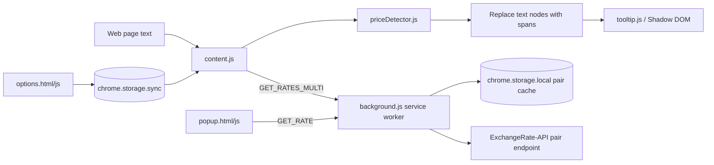
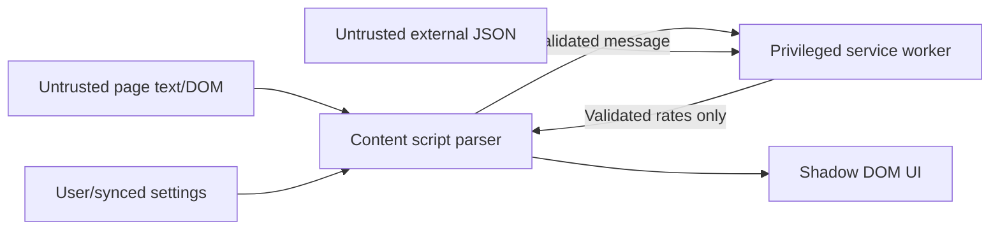

# Forex Hover Pro — Project Audit

Audit date: 2026-09-21  
Scope: every file currently in the repository, the rendered popup/options surfaces, current Chrome extension guidance, the exchange-rate provider boundary, and comparable browser extensions.

## Executive verdict

Forex Hover Pro already has a coherent core: detect prices in page text, fetch exchange rates through an MV3 service worker, and show conversions without leaving the page. The strongest parts are the small dependency-free footprint, the separation of price detection from DOM code, Shadow DOM tooltip isolation, persistent rate caching, and a visually distinctive popup/options experience.

It is not production-ready yet. The main blockers are correctness and trust, not missing scale infrastructure:

1. A live API credential is embedded in `background.js`. It must be revoked and removed.
2. The parser passes only 6 of 16 representative fixtures. It truncates ungrouped amounts with four or more digits (`¥1200` becomes `¥120`), cannot detect suffix formats despite claiming support, misreads Indian grouping, and treats negative prices as positive.
3. Three settings presented as working—domain overrides, selection mode, and underline visibility—are saved but never consumed by the content script.
4. A cache miss performs one provider request per target currency, although the provider supports returning all rates for one base in a single response.
5. Every page is scanned and its text nodes are replaced with spans. That can block the main thread, interfere with page frameworks, and still misses direct text-node mutations.
6. The extension asks for `tabs`, `contextMenus`, and `unlimitedStorage` without a current need. Chrome Web Store policy requires the narrowest permissions that implement shipped features.
7. There are no tests, build/release scripts, CI checks, README, privacy documentation, or Git repository metadata.

The recommendation is to evolve the existing extension in place. Keep Manifest V3, the content-script/service-worker split, local-first storage, and native HTML/CSS. Replace the fragile parser, N-request rate path, and DOM-wrapping scanner; add a persistent side-panel workspace only after the core is correct.

## Current product

### What it does today

- Injects on all HTTP(S) pages through a Manifest V3 content script.
- Detects a subset of symbol-prefixed and ISO-prefixed currency amounts.
- Replaces detected text nodes with annotated `` elements.
- Shows a Shadow DOM tooltip on hover or after selecting text.
- Converts into multiple configured target currencies.
- Provides a popup manual converter and session-only history.
- Provides an options page for target currencies, domain overrides, and behavior toggles.
- Caches pair rates in `chrome.storage.local` for 30 minutes.

### Current architecture

### Current technology inventory

| Area | Current choice | Assessment |
|---|---|---|
| Browser platform | Chrome Manifest V3 | Keep |
| Language | Plain JavaScript with IIFEs/globals | Works, but shared contracts and data have drifted |
| UI | Native HTML/CSS/JS | Keep; no framework is justified |
| Content isolation | Shadow DOM tooltip | Keep |
| Persistence | `chrome.storage.sync` preferences, `chrome.storage.local` cache | Keep, with schemas and validation |
| Rate source | ExchangeRate-API v6 pair endpoint | Endpoint usage is inefficient; credential handling is unsafe |
| Build tooling | None | Add the minimum needed for modules, type checking, tests, and packaging |
| Tests/CI | None | Production blocker |
| Deployment | Manual unpacked extension | Add reproducible release artifacts before store distribution |

## Baseline evidence

| Metric | Baseline | Evidence |
|---|---:|---|
| Source size | 3,539 lines / 118,489 bytes | Nine text source files |
| JavaScript syntax | 6/6 files pass `node --check` | `background.js`, `content.js`, `priceDetector.js`, `tooltip.js`, `popup.js`, `options.js` |
| Representative detector fixtures | 6/16 pass | Direct invocation of `PriceDetector.detect` |
| Automated tests | 0 | No test files or test runner |
| CI workflows | 0 | No CI configuration |
| Documented settings actually wired | 2/5 | `enabled` and target currencies work; domain override, selection mode, and underline do not |
| Declared named permissions justified | 1/4 | `storage` is used; `tabs` is unnecessary for current calls; `contextMenus` is unused; `unlimitedStorage` is unnecessary |
| Requests on an uncached multi-target hover | O(target currencies) | `getRatesMulti()` calls the pair endpoint once per target |
| Currency catalogs | 4 divergent copies | Detector: 20, tooltip flags: 20, popup: 36, options: 50 |
| Git metadata | Absent | Workspace is not a Git repository |

The fixture baseline is intentionally small and diagnostic, not a claim of real-world precision/recall. A versioned corpus is an implementation milestone.

## Findings by severity

### Critical

#### C1 — Credential disclosed in packaged source

`background.js` contains a real provider key. Every installed extension package is inspectable, so a bundled key is public. The key is also placed in the request URL. It should be revoked immediately; removing it from a later commit does not make the old key safe.

Remedy: switch the default rate path to a keyless provider, or use a deliberately operated gateway if commercial-rate SLAs later require a secret. Never ship a shared secret in the extension.

#### C2 — Price detection corrupts common amounts

The regular expression chooses the one-to-three-digit branch before the unrestricted branch, so ungrouped four-digit values are truncated. It also requires a prefix even though comments and UI claim suffix support. Indian grouping, multi-character symbols, apostrophe grouping, and negatives are wrong or unsupported.

Remedy: replace the single master regex with a small tokenizer/parser and a table-driven fixture corpus. Do not patch individual examples into the current expression.

### High

#### H1 — Shipped settings do not control runtime behavior

`domainOverrides`, `selectionMode`, and `underline` are written to sync storage but never read by `content.js`. The options page and About copy claim these capabilities work.

Remedy: either wire each setting end-to-end with tests or remove it until implemented. The proposed plan wires them because they directly improve ambiguity, privacy, and UX.

#### H2 — Rate fetching is an N-request fan-out

Each target currency triggers an independent pair request. A three-target tooltip can cost three quota units and three network operations. ExchangeRate-API's standard endpoint and Frankfurter's rates endpoint both support one-base/many-quote responses.

Remedy: cache one validated rate snapshot per base and fulfill all target conversions from that snapshot. Deduplicate concurrent fetches.

#### H3 — Persistent all-page DOM mutation is risky and wasteful

The content script scans the entire body, replaces text nodes, adds per-span listeners, and observes added element nodes. This can invalidate page-held text node references and does work on pages the user never interacts with. The observer misses added text nodes and `characterData` changes.

Remedy: make hover detection pointer-driven with `caretPositionFromPoint()` (and Chromium fallback), leaving the page DOM untouched. Use the CSS Custom Highlight API only when the user enables underlines; update highlights incrementally.

#### H4 — Trust boundaries are not validated

Runtime messages, synced preferences, provider payloads, rate values, target-list sizes, and domain strings are assumed valid. Several paths render strings through `innerHTML`.

Remedy: validate message shape, currency codes, finite positive rates, target count, cache records, and domains at their boundaries. Build UI with DOM nodes and `textContent` for variable content.

#### H5 — No regression safety net

There are no tests for the parser, cache, messages, settings migrations, popup, options page, or injected behavior. The current documentation/behavior contradictions would have been caught by one end-to-end smoke suite.

Remedy: start with detector and settings fixtures, then service-worker cache tests, then five Puppeteer extension flows.

### Medium

#### M1 — Permissions exceed implemented behavior

- `tabs` is not required for basic `tabs.query()` or `tabs.sendMessage()` calls.
- `contextMenus` is declared but unused.
- `unlimitedStorage` is unnecessary for a small rate cache.
- `<all_urls>` is necessary only for automatic operation everywhere; a more trustworthy mode is optional site access plus `activeTab`.

Remedy: ship the minimum permission set for each milestone. Re-add `contextMenus` only with the accessible “convert selection” action. Offer per-site/all-sites access deliberately rather than silently broadening scope.

#### M2 — Service-worker lifecycle explanation is incorrect

Comments say service-worker idling invalidates a content-script runtime. Chrome documents that incoming events revive an idle extension service worker. A content script is typically invalidated by extension reload/update, not normal worker suspension.

Remedy: keep the reload/update guard, remove the false lifecycle explanation, and test worker restart behavior.

#### M3 — Extension-page CSP and remote assets are not release-clean

`options.html` contains an inline script that MV3's extension-page CSP will not execute. Both HTML pages depend on Google Fonts, creating an unnecessary remote request and a packaging/policy risk. Navigation logic is duplicated in `options.js` and the blocked inline script.

Remedy: remove the inline script, bundle any required assets, or prefer the system font stack. Keep all extension logic and styling reviewable in the package.

#### M4 — UI state and accessibility are incomplete

- Popup amount/select controls lack proper labels/accessibility names.
- Custom toggles have weak focus treatment.
- Status text can say “Active on this page” even where content scripts cannot run.
- Dynamic save/results feedback has no live-region semantics.
- There is no `prefers-reduced-motion` mode.
- Dim text likely fails contrast in several locations.
- The options page has no small-viewport layout.
- The icon says “FXconvert” while the product is “Forex Hover Pro.”

Remedy: make the side panel/popup keyboard complete, name controls, add live regions and reduced motion, test contrast/focus order, and unify branding.

#### M5 — Data duplication has already caused drift

Currency metadata is copied into four files with different coverage. Decimal precision uses hand-maintained lists and fails for three-decimal currencies such as KWD and BHD.

Remedy: one currency catalog; use `Intl.NumberFormat` currency metadata/formatting where possible and keep only genuinely provider-specific metadata locally.

### Low

- `options.html` is 1,380 lines with two style blocks; split by responsibility after behavior is covered by tests.
- Settings saves query all tabs twice; one query/broadcast is sufficient.
- Popup opens with a provider check request even if the user does not convert.
- Session history disappears when the popup closes; the planned side panel makes session continuity more useful.
- Comments such as “Final” and version labels are stale and add no maintenance value.

## Performance and reliability assessment

### Current bottlenecks

1. Full-document synchronous scan at startup.
2. Per-match DOM replacement and two listeners per span.
3. Repeated subtree scans after broad mutation batches.
4. N provider calls per base/target set on cache miss.
5. No request timeout or cancellation.
6. No in-flight request coalescing, so simultaneous hovers can duplicate work.
7. Cache freshness is based on local fetch time, not provider observation/update time.

### Failure behavior today

| Failure | Current behavior | Needed behavior |
|---|---|---|
| Provider offline/slow | Spinner waits for fetch; no timeout | Bounded timeout, stale-cache fallback, explicit freshness |
| Quota exhausted | Error per target | One actionable provider-status error |
| Corrupt sync preferences | Values propagate into messages/UI | Repair to schema defaults and persist repaired value |
| Service worker restarts | Cache survives; comments imply context loss | Expected wake/retry path covered by E2E test |
| Page updates a text node | Often missed | Pointer detection works without mutation tracking; underline mode updates incrementally |
| Extension reloads | Existing page context becomes stale | Quiet teardown plus visible refresh hint in popup/side panel |
| Partial rate payload | Can throw during rendering | Validate snapshot atomically; keep prior good snapshot |

## Security and privacy model

### Trust boundaries

Assets worth protecting are provider credentials, browsing context, saved comparison items, synced preferences, and extension privileges. The main abuse cases are malformed messages causing unbounded requests, injected strings entering extension-page HTML, excessive page access, provider responses corrupting calculations, and accidental collection of browsing history.

The target remains local-first: page text is parsed in the tab, only currency codes are sent for rate lookup, saved items stay in `chrome.storage.local`, and no analytics is enabled by default. If optional telemetry is ever proposed, it requires a separate privacy decision, prominent consent, minimization, and retention policy.

## What should remain unchanged

- The core promise: immediate contextual conversion while browsing.
- Manifest V3 and the service-worker/content-script boundary.
- Native browser UI rather than a SPA framework.
- Shadow DOM isolation for the tooltip.
- Local/sync extension storage instead of an external account system.
- A manual converter as a fallback and accessibility path.
- A privacy-first, no-tracking default.

## Audit conclusion

The project does not need microservices, a database, authentication, AI, or a rewrite. It needs a trustworthy parser, one rate snapshot per base, non-invasive page integration, honest settings, permission minimization, and tests. Once those foundations are complete, the side-panel comparison workspace and historical context provide the most cohesive expansion and the best engineering/demo story.

