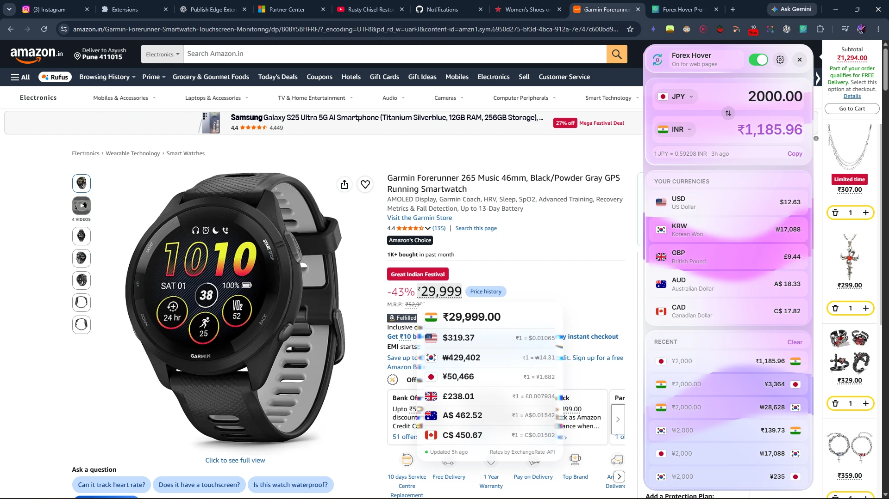
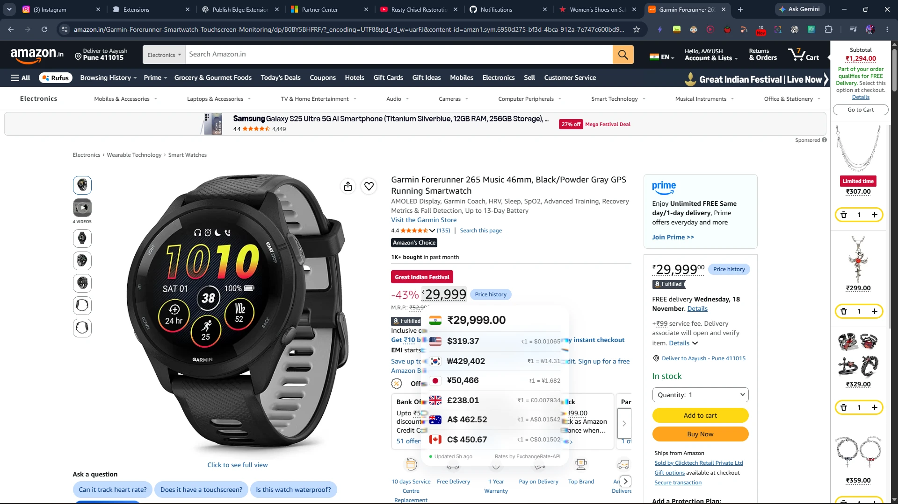
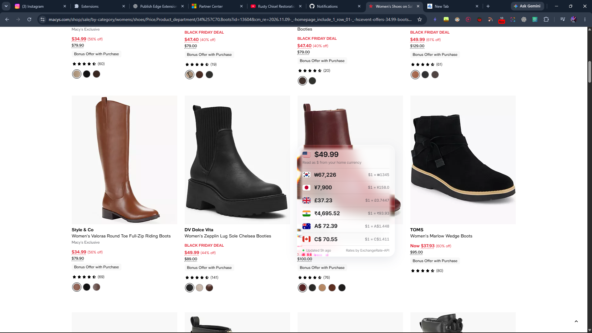
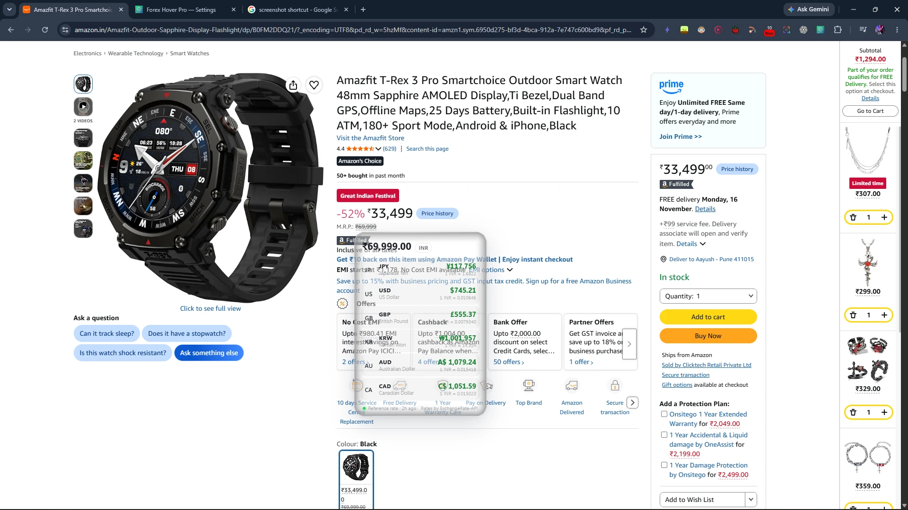
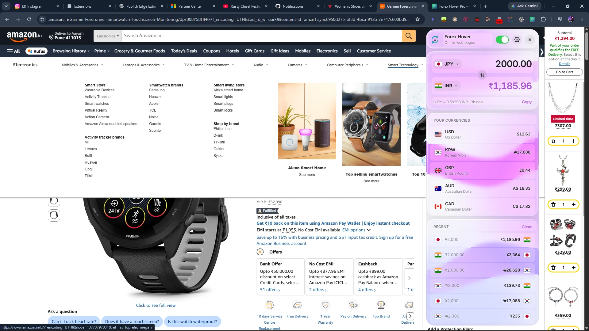
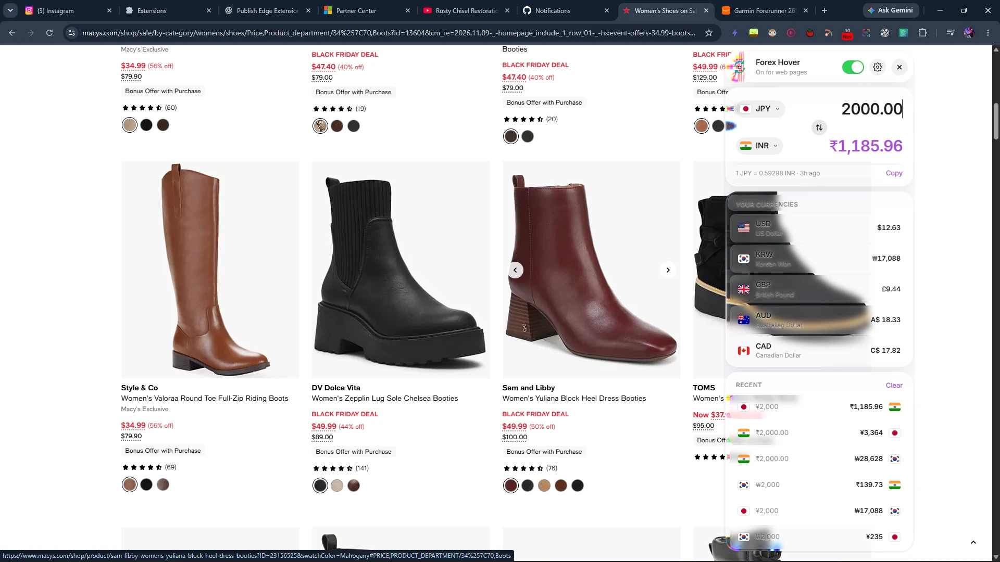
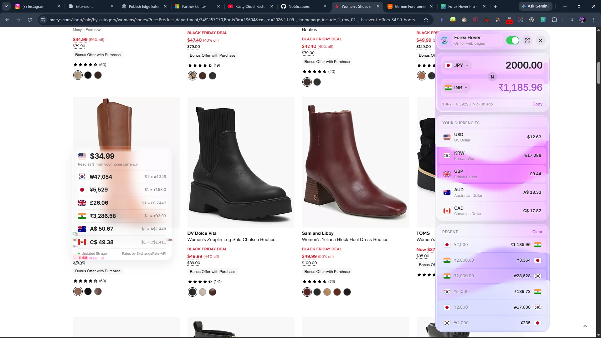
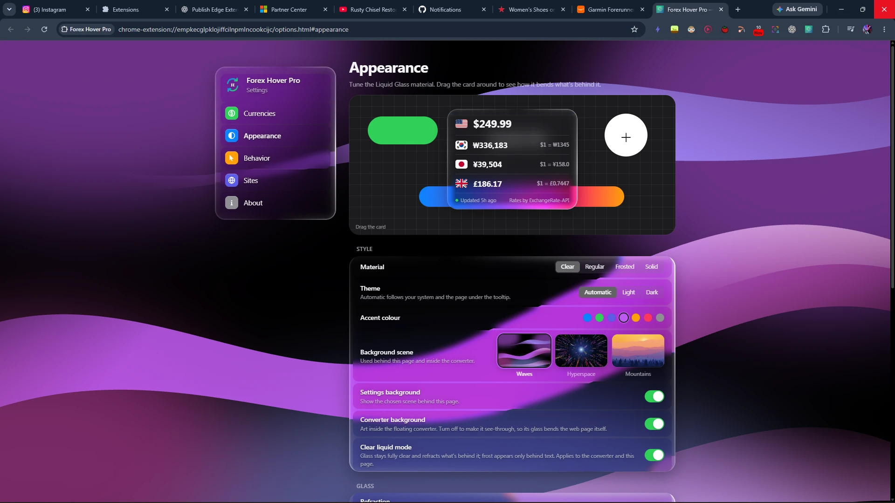
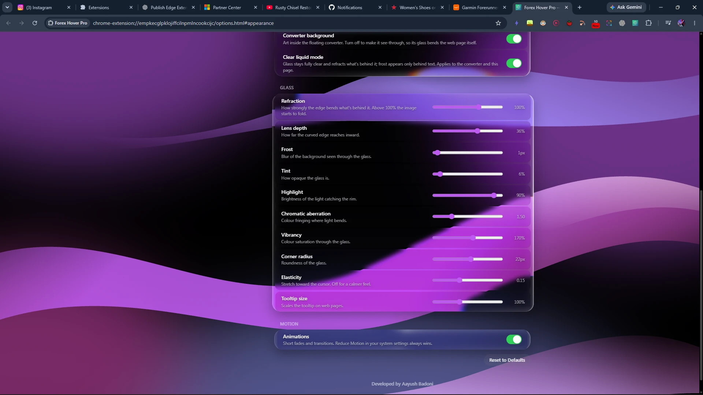
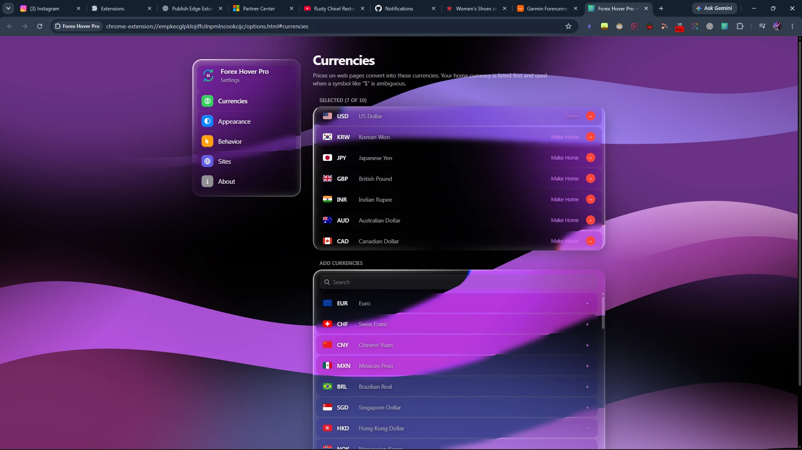

<div align="center">


# Forex Hover Pro

### Hover any price. See it in your currency. Instantly.

A Chrome extension that converts prices right where you browse, in a floating Liquid Glass interface inspired by Apple's design. No extra tabs, no API key, no account, no tracking.

[](https://developer.chrome.com/docs/extensions/)
[](https://developer.chrome.com/docs/extensions/mv3/intro/)
[](#-installation)
[](https://github.com/AayushBadoni18/Forex-Hover/releases/latest)

[**Download**](https://github.com/AayushBadoni18/Forex-Hover/releases/latest) · [**Install guide**](#-installation) · [**Features**](#-features) · [**Gallery**](#%EF%B8%8F-gallery)

<br/>



<sub><em>Live on Amazon.in: hover a price for instant conversions, while the floating glass converter sits beside it.</em></sub>

</div>

---

## 💡 Why I built this

I was constantly switching tabs just to convert prices while browsing international websites. Whether looking at tech products, courses, or tools, I'd see a price in a foreign currency and immediately open another tab to check what it meant in mine. It was repetitive, distracting, and unnecessary.

**Forex Hover Pro solves that.**

Hover over (or select) any price on any webpage, and it instantly shows the converted value in all your chosen currencies, right next to the price. Need to convert something yourself? Click the icon and a glass converter floats onto the page. Install it and go.

---

## ✨ Features

<table>
<tr>
<td width="50%" valign="top">

### 🖱️ Hover to convert
Hover any price and a Liquid Glass card shows it in every currency you follow, with country flags and the live rate. Works on shopping sites, travel sites, docs, anything.

### 🔎 Detection that actually works
Reads prices the way they're written around the world:
`$1,299.99` · `1.299,00 €` · `₹1,23,456` · `CHF 2'490.00` · `¥64,800` · `99.95 USD`

…including the tricky ones: prices split across elements (Amazon-style superscript cents), tiny or raised symbols, symbols on their own line or drawn by CSS, and prices that update while you browse.

### 🧭 Knows what `$` means
`$` could be US, Canadian or Australian dollars. Forex Hover Pro works it out from your site rules, the page's language and the site's country, and the tooltip tells you when it made an assumption.

### ✂️ Selection mode
Select any text containing a price ("shipping costs 29,95 EUR") and the conversion appears at your cursor.

</td>
<td width="50%" valign="top">

### 🪟 Floating glass converter
Click the toolbar icon and a converter appears **on the page**. Drag it anywhere and watch the glass refract and catch the light from whatever is behind it. Click the icon again (or press Esc) to put it away.

### 💎 Real Liquid Glass
Lens refraction at the edges, colour fringing, and a specular rim that follows your cursor. Fully tunable: Clear / Regular / Frosted / Solid presets, sliders for refraction, depth, frost, tint and more, plus a **Clear liquid mode** where the glass stays fully transparent.

### 🌌 Background scenes
Choose **Hyperspace**, **Mountains** or **Waves** for the settings page and the converter, each tinted by your accent colour, with separate on/off switches for each.

### 🔑 No API key, works offline
Free daily reference rates with an automatic fallback source. Rates are cached, so conversions keep working offline (clearly labelled).

### 🔒 Private
No account, no analytics. Page text never leaves your browser.

</td>
</tr>
</table>

---

## 🖼️ Gallery

All screenshots are from real shopping sites, taken with the extension running live.

### Hover any price

<table>
  <tr>
    <td width="50%"></td>
    <td width="50%"></td>
  </tr>
  <tr>
    <td align="center"><b>Amazon.in</b><br/><sub>₹29,999 on a Garmin watch, converted into six currencies with flags and live rates. Amazon's split price (tiny ₹, big digits) is read correctly.</sub></td>
    <td align="center"><b>Macy's</b><br/><sub>A $49.99 boot. The tooltip notes it read “$” as US dollars, and the glass bends the product photo behind it.</sub></td>
  </tr>
</table>

### Clear liquid glass

<div align="center">
  
  <br/><sub>With <b>Clear liquid mode</b> on, the tooltip is pure glass: the page underneath stays visible and bends at the edges, while a light veil keeps the numbers readable.</sub>
</div>

### The floating converter

Click the toolbar icon and the converter appears right on the page. Drag it anywhere, convert anything, and close it with a second click.

<table>
  <tr>
    <td width="50%"></td>
    <td width="50%"></td>
  </tr>
  <tr>
    <td align="center"><b>Waves background</b><br/><sub>Silk ribbons in your accent colour flow behind the glass cards. Your currencies and recent conversions are one tap away.</sub></td>
    <td align="center"><b>See-through</b><br/><sub>Turn the converter background off and the glass refracts the web page itself. Drag it over the page and watch it bend.</sub></td>
  </tr>
  <tr>
    <td colspan="2"></td>
  </tr>
  <tr>
    <td colspan="2" align="center"><b>Both at once</b><br/><sub>Hover prices on the page while the converter stays open. Here a $34.99 boot on Macy's converts in the tooltip while ¥2,000 is worked out in the converter.</sub></td>
  </tr>
</table>

### Settings

<table>
  <tr>
    <td width="50%"></td>
    <td width="50%"></td>
  </tr>
  <tr>
    <td align="center"><b>Appearance</b><br/><sub>A draggable live preview, material presets, theme, accent colour, the Waves / Hyperspace / Mountains scene picker, and the background and Clear liquid switches.</sub></td>
    <td align="center"><b>Glass controls</b><br/><sub>Refraction, lens depth, frost, tint, highlight, chromatic aberration, vibrancy, corner radius, elasticity and tooltip size.</sub></td>
  </tr>
  <tr>
    <td colspan="2"></td>
  </tr>
  <tr>
    <td colspan="2" align="center"><b>Currencies</b><br/><sub>Pick up to 10 of 57 currencies. The first is your home currency, used when a symbol like “$” is ambiguous.</sub></td>
  </tr>
</table>

---

## 📦 Installation

Forex Hover Pro isn't on the Chrome Web Store yet, so you install it yourself. It takes about two minutes and needs **no account and no API key**. These steps work in Google Chrome, and in Edge, Brave or Arc (which use the same engine).

### Option 1: Download and install (no coding needed)

**Step 1. Download the extension**

1. Go to the [**Releases page**](https://github.com/AayushBadoni18/Forex-Hover/releases/latest).
2. Under **Assets**, click **`forex-hover-pro-v3.1.0.zip`** to download it.

**Step 2. Unzip it**

- **Windows:** right-click the downloaded file → **Extract All…** → **Extract**.
- **Mac:** double-click the downloaded file.

You now have a folder named `forex-hover-pro-v3.1.0`. Move it somewhere you'll keep it, such as your Documents folder. **Don't delete it later**: Chrome loads the extension from this folder.

**Step 3. Open Chrome's extensions page**

Type `chrome://extensions` into the address bar and press **Enter**.
(Edge: `edge://extensions` · Brave: `brave://extensions`)

**Step 4. Turn on Developer mode**

Flip the **Developer mode** switch in the top-right corner of the page. In Edge it's in the left sidebar.

**Step 5. Load the extension**

1. Click **Load unpacked**, the button that appears at the top-left.
2. Select the **`forex-hover-pro-v3.1.0`** folder from Step 2. Select the folder itself, not a file inside it.
3. Click **Select Folder**.

Forex Hover Pro now appears in your list of extensions.

**Step 6. Pin it to your toolbar**

Click the 🧩 puzzle-piece icon at the top-right of Chrome, then click the 📌 pin next to **Forex Hover Pro**.

**Step 7. Try it**

1. Open any shopping site and **hover your mouse over a price**. A glass card appears with the price in other currencies.
2. Click the Forex Hover Pro icon in your toolbar: a glass converter appears on the page. Drag it by its header; click the icon again to close it.
3. Click the ⚙️ gear in the converter to open **Settings**: pick your currencies, choose a background scene and tune the glass.

> **Tip:** pages that were open before you installed need a refresh (F5) before hovering works. The converter works on them straight away.

### Option 2: Build from source (for developers)

You'll need [Git](https://git-scm.com/downloads) and [Node.js 24+](https://nodejs.org/).

```sh
git clone https://github.com/AayushBadoni18/Forex-Hover.git
cd Forex-Hover
npm ci --ignore-scripts
npm run build
```

Then follow Steps 3–7 above, selecting the generated **`dist`** folder in Step 5. After changing the code, run `npm run build` again and click the ↻ reload icon on the extension's card in `chrome://extensions`.

### Updating to a new version

Download the new zip from Releases, unzip it over the old folder (replace the files), then click ↻ **reload** on Forex Hover Pro's card in `chrome://extensions`. Your settings are kept.

### Uninstalling

Open `chrome://extensions`, click **Remove** on Forex Hover Pro, then delete the folder.

### Troubleshooting

| Problem | Fix |
|---|---|
| **Load unpacked** button is missing | Turn on **Developer mode** (Step 4). |
| "Manifest file is missing or unreadable" | You picked the wrong folder. Pick the folder that **directly contains** `manifest.json`. |
| Nothing happens when I hover a price | Refresh the page. Check that the switch in the converter is on, and that the price isn't already in one of your chosen currencies. |
| A site shows no prices at all | Some stores hide prices for your delivery country (for example Amazon.com outside the US shows "See options"). There's nothing to convert until a price is shown. |
| The converter opens in a small window | That happens on Chrome's own pages (New Tab, `chrome://`, the Web Store), where extensions can't draw on the page. |
| "Rates unavailable" | Check your internet connection. Once rates have loaded once, they keep working offline (labelled *Offline*). |
| Chrome warns about "developer mode extensions" at startup | That's normal for extensions not installed from the Web Store. Click × to dismiss it. |

---

## 🧭 Using it

| What | How |
|---|---|
| **Convert a price** | Hover it. Prices you can hover get a subtle dotted underline. |
| **Convert any text** | Select text that contains a price. |
| **Read big numbers** | `$1.5M`, `$3k`, `$2.5 billion` and `₹5 crore` convert at their full value; `$25 CAD` uses the code, not a guess. |
| **Open the converter** | Click the toolbar icon or press `Alt+Shift+F`. Drag it by its header. Close with the icon, ×, or Esc. |
| **Swap / change currencies** | Use the ⇅ button, or click a flag to search all 57 currencies. |
| **Reuse a conversion** | Tap any row under *Recent* or *Your currencies*. |
| **Choose your currencies** | Settings → **Currencies**. The first one is your home currency. |
| **Change the look** | Settings → **Appearance**: material presets, theme, accent colour, background scene, Settings/Converter background switches, Clear liquid mode, and glass sliders. |
| **Fix an ambiguous `$`** | Settings → **Sites**: e.g. `amazon.ca → CAD`. |
| **Pause on web pages** | The switch in the converter's header, or Settings → **Behavior**. |

Everything saves automatically and applies live in every open tab.

---

## 🛠️ Development

```sh
npm run typecheck   # TypeScript
npm test            # unit tests (node:test)
npm run test:e2e    # builds, then loads the extension in Chrome
npm run build       # writes the unpacked extension to dist/
```

| Path | Responsibility |
|---|---|
| `manifest.json` | MV3 manifest, permissions, entry points |
| `background.js` | Service worker: toolbar icon, validated messages, rate snapshot cache |
| `content.js` | Page runtime: price detection, hover and selection, live settings |
| `tooltip.js` | Shadow-DOM Liquid Glass hover tooltip |
| `panel.js` | The floating, draggable converter on the page |
| `popup.*` | Fallback converter window for Chrome's own pages |
| `options.*` | Settings page |
| `src/shared/` | Currency catalog, contracts, validation, price parser, currency resolver, formatting, rates |
| `src/ui/` | Glass engine, converter, background scenes, appearance settings, tooltip view, flags, icons |
| `tests/` | Unit tests, fixtures, and the Chrome smoke test |

Design and planning docs: [Architecture](docs/ARCHITECTURE.md) · [Decisions](docs/DECISIONS.md) · [Features](docs/FEATURES.md) · [Roadmap](docs/ROADMAP.md) · [Implementation plan](docs/IMPLEMENTATION_PLAN.md) · [Audit](docs/PROJECT_AUDIT.md)

---

## 🔐 Permissions

| Permission | Why |
|---|---|
| `storage` | Save your settings, recent conversions and cached rates |
| `activeTab`, `scripting` | Open the converter on a tab when you click the icon, even if the tab was open before install |
| `cdn.jsdelivr.net`, `open.er-api.com` | Fetch daily reference exchange rates (primary + fallback) |
| Content script on all sites | Detect prices on the pages you visit |

## 🛡️ Privacy

No account, no analytics, no telemetry. Page text is processed locally and never uploaded; only currency codes are sent to the rate services. Rates are daily mid-market reference rates, not a trading quote. Full policy: [PRIVACY.md](./PRIVACY.md).

---

## 🙏 Credits

- Daily rates from [fawazahmed0/exchange-api](https://github.com/fawazahmed0/exchange-api), with [ExchangeRate-API](https://www.exchangerate-api.com) as a fallback.
- Liquid Glass refraction technique adapted from [liquid-glass-react](https://github.com/rdev/liquid-glass-react) (MIT).
- Flags from [flag-icons](https://github.com/lipis/flag-icons) (MIT); [Inter](https://rsms.me/inter/) (OFL) on non-Apple platforms, SF Pro on Apple devices.

<div align="center">
<br/>

**Developed by Aayush Badoni**

If Forex Hover Pro saves you a few tabs, consider giving the repo a ⭐

</div>
