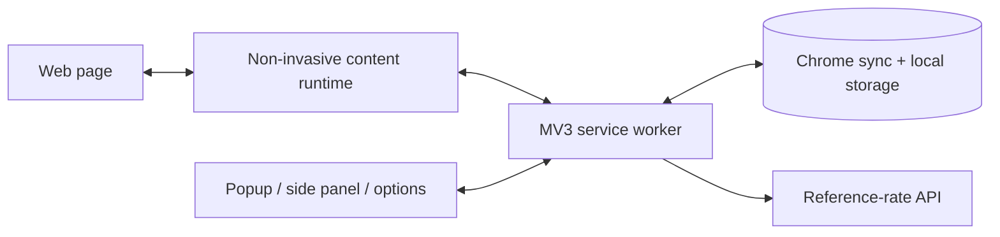

# Forex Hover Pro

Instant, contextual currency conversion while browsing—without leaving the page.

> Upgrade status: v3 implementation is in progress. See [PROJECT_AUDIT.md](PROJECT_AUDIT.md) and [IMPLEMENTATION_PLAN.md](IMPLEMENTATION_PLAN.md).

## Problem

International shopping, travel research, and global software pricing repeatedly force users to copy a price, open a converter, choose currencies, and return to the original page. Forex Hover Pro keeps that context in place: point at or select a price and see the amount in currencies you understand.

## Vision

Forex Hover Pro v3 is proposed as a local-first currency intelligence workspace:

- accurate price parsing across common locale and symbol formats;
- explainable handling of ambiguous symbols such as `$` and `¥`;
- instant cached multi-currency conversion with clear freshness;
- non-invasive hover and optional page highlights;
- a persistent side panel for manual conversion, pinned prices, cross-tab comparison, and historical reference context;
- no account, no tracking, and no page-text upload.

## Current v2 features

- Chrome Manifest V3 extension.
- Hover and selected-text conversion.
- Multi-currency tooltip isolated with Shadow DOM.
- Manual popup converter and session history.
- Target-currency settings.
- Service-worker rate cache in `chrome.storage.local`.
- Options UI for currencies, domain rules, and behavior.

Important: domain overrides, selection mode, and underline toggles are currently displayed/saved but are not wired into runtime behavior. Price parsing also has known correctness failures documented in the audit.

## Proposed v3 capabilities

- Table-driven, locale-aware parser with a benchmark corpus.
- Domain/locale evidence with visible currency assumptions.
- One batched rate snapshot per base and stale/offline fallback.
- Pointer-driven detection without replacing host-page text nodes.
- Optional CSS Custom Highlight underlines.
- Accessible popup, tooltip, side panel, and options experience.
- Local comparison board and on-demand 30/90-day rate context.
- Local diagnostics, automated unit/E2E tests, and reproducible release packaging.

## Architecture overview



The browser remains the application platform. No backend, database, authentication system, queue, or AI service is proposed for v3. See [ARCHITECTURE.md](ARCHITECTURE.md) for components, data flow, failure handling, security, and scaling.

## Repository contents

| File | Current responsibility |
|---|---|
| `manifest.json` | MV3 manifest, permissions, entry points |
| `background.js` | Rate fetching and local pair cache |
| `priceDetector.js` | Pure price detection/formatting helpers |
| `content.js` | Page scanning, annotations, selection handling, messages |
| `tooltip.js` | Shadow DOM tooltip rendering/positioning |
| `popup.html` / `popup.js` | Quick controls, converter, session history |
| `options.html` / `options.js` | Settings UI and persistence |
| `icons/` | Extension icons |

## Run the current extension locally

1. Open `chrome://extensions`.
2. Enable **Developer mode**.
3. Choose **Load unpacked**.
4. Select this repository folder.
5. Open a normal HTTP(S) page and click the extension action.

Security warning: `background.js` currently contains an exposed provider credential. Treat it as compromised and revoke it before using or distributing this repository. The approved implementation plan removes the need to package a shared key.

There is currently no package manager, build command, automated test command, or CI pipeline. JavaScript syntax can be checked with:

```powershell
Get-ChildItem -Filter *.js | ForEach-Object { node --check $_.FullName }
```

## Usage

- Hover a detected price to request conversions in selected target currencies.
- Select text containing a price to show a tooltip near the pointer.
- Open the popup for a manual conversion.
- Open **Full Settings** to choose targets and edit other preferences.

The audit identifies formats and preferences that are currently unreliable. Do not treat the current output as a financial or trading quote.

## Documentation

- [Project audit](PROJECT_AUDIT.md)
- [Research](RESEARCH.md)
- [Architecture](ARCHITECTURE.md)
- [Technology stack](TECH_STACK.md)
- [Feature catalog](FEATURES.md)
- [Implementation plan](IMPLEMENTATION_PLAN.md)
- [Decision log](DECISIONS.md)
- [Roadmap](ROADMAP.md)
- [Review checklist](REVIEW_CHECKLIST.md)

## Demo plan

The approved v3 demo should show four short stories:

1. Ambiguous and localized prices are detected correctly, with the assumption explained.
2. Repeated hovers return immediately from one validated snapshot while an offline provider still yields labeled stale data.
3. Prices from multiple tabs are pinned and normalized in the side panel.
4. Tests/diagnostics demonstrate parser accuracy, request reduction, permission minimization, and page-performance targets.

Screenshot placeholders:

- `docs/images/tooltip-demo.png` — locale-aware hover tooltip.
- `docs/images/side-panel-comparison.png` — pinned cross-tab comparison.
- `docs/images/rate-context.png` — historical reference context.
- `docs/images/diagnostics.png` — local reliability/performance evidence.

These assets should be added only after the approved UI exists.

## Roadmap

The near-term priority is correctness and safety, not more features. Parser/currency resolution, secret removal, batched caching, settings wiring, and tests precede the side-panel workspace and historical context. See [ROADMAP.md](ROADMAP.md).

## Project status

Planning documents are complete and implementation is waiting for user approval. The current workspace is not yet a Git repository.

## License

No license file is present. Choose and add a license before public distribution or accepting contributions.
