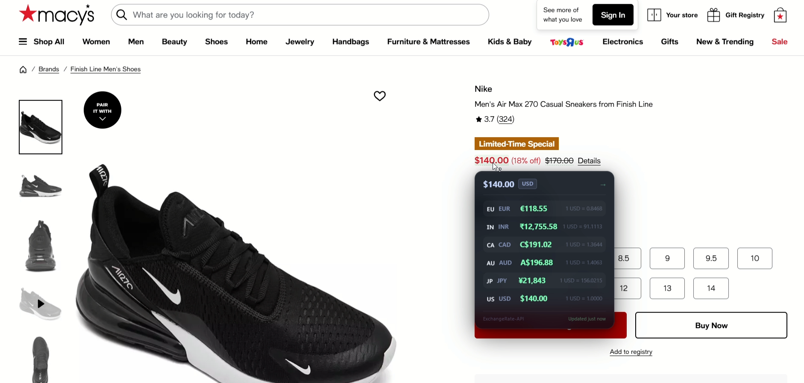
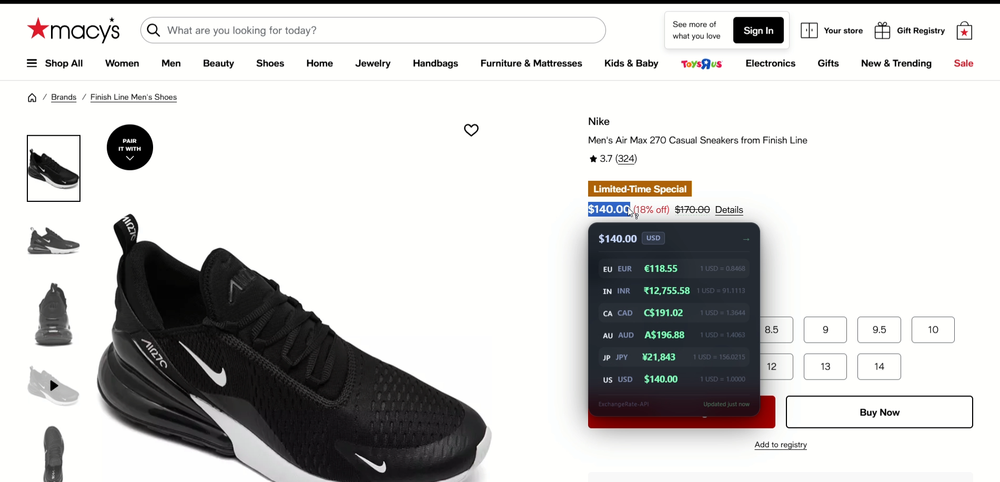
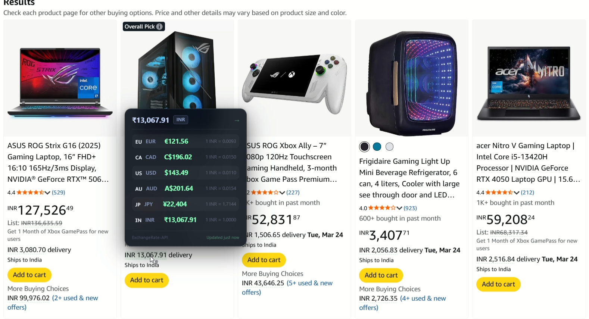
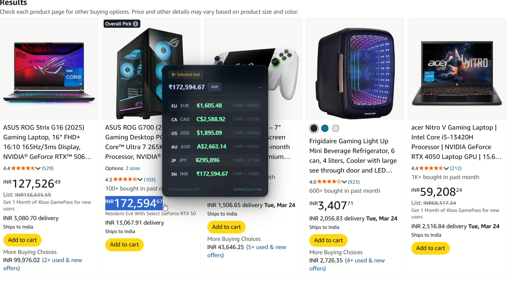
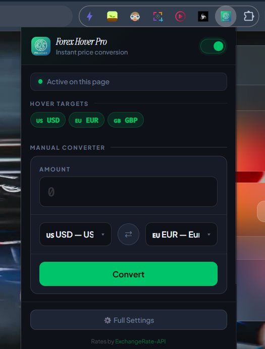
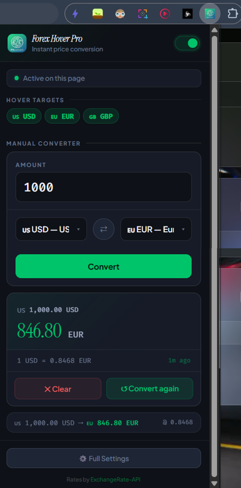

<div align="center">


# Forex Hover Pro

**Instant, multi-currency price conversion — right where you browse.**

[](https://developer.chrome.com/docs/extensions/)
[](https://developer.chrome.com/docs/extensions/mv3/intro/)
[](#installation)

</div>

---

## Why I built this

I was constantly switching tabs just to convert prices while browsing international websites. Whether looking at tech products, courses, or tools, I'd see a price in a foreign currency and immediately open another tab to check what it meant in mine. It was repetitive, distracting, and unnecessary.

**Forex Hover Pro solves that.**

Hover over — or select — any price on any webpage, and it instantly shows the converted value in all your chosen currencies. No extra tabs. No manual calculations. No API key. Install it and go.

---

## Features

- 🖱️ **Hover to convert** — hover any detected price and see every conversion, with flags, in a floating Liquid Glass tooltip
- ✂️ **Text selection mode** — highlight any text containing a price and the tooltip appears at your cursor
- 💱 **Multi-currency** — up to 10 target currencies at once, from a catalog of 50
- 🔢 **Live popup converter** — converts as you type, searchable currency picker with flags, shows the amount in all your currencies
- 🕘 **Recent conversions** — kept across popup sessions
- 🔎 **Smart detection** — handles `1.200,50 €`, `₹1,23,456`, `CHF 1'234.50`, prices split across elements (Amazon-style) and prices that update live; ambiguous `$`/`¥`/`kr` are resolved from site rules, page language and the site's country, and the tooltip says when it assumed
- ✨ **Liquid Glass design** — Apple-inspired: lens refraction at the edges, a specular rim and subtle colour fringing, tunable in Settings (Clear / Regular / Frosted / Solid, sliders, light/dark/auto, accent colours) with a live, draggable preview
- 🔑 **No API key** — keyless reference rates from ExchangeRate-API with an automatic fallback provider
- 📴 **Works offline** — one cached snapshot per currency; when offline you see the last rates, clearly labelled
- 🌐 **Site rules** — tell it what `$` means on a given site (e.g. `amazon.ca → CAD`)
- 🔒 **Zero tracking** — no analytics, no account; page text never leaves your browser

---

## Screenshots

> These screenshots are from v2. The v3 Liquid Glass UI screenshots are coming soon.

### Hover Conversion — Macy's

<table>
  <tr>
    <td></td>
    <td></td>
  </tr>
  <tr>
    <td align="center"><em>Hover — tooltip appears automatically</em></td>
    <td align="center"><em>Selection mode — highlight a price to convert</em></td>
  </tr>
</table>

### Hover & Selection — Amazon India

<table>
  <tr>
    <td></td>
    <td></td>
  </tr>
  <tr>
    <td align="center"><em>Hover on Amazon.in — ₹ detected and converted</em></td>
    <td align="center"><em>Selection mode — highlight any price in any text</em></td>
  </tr>
</table>

### Popup — Manual Converter

<table>
  <tr>
    <td></td>
    <td></td>
  </tr>
</table>

---

## Installation

Forex Hover Pro isn't on the Chrome Web Store yet, so you install it yourself. It takes about two minutes and needs **no account and no API key**. These steps work in Google Chrome, and in Edge, Brave or Arc (which use the same engine).

### Option 1 — Download and install (no coding needed)

**Step 1. Download the extension**

1. Go to the [**Releases page**](https://github.com/AayushBadoni18/Forex-Hover/releases/latest).
2. Under **Assets**, click **`forex-hover-pro-v3.0.0.zip`** to download it.

**Step 2. Unzip it**

- **Windows:** right-click the downloaded file → **Extract All…** → **Extract**.
- **Mac:** double-click the downloaded file.

You now have a folder named `forex-hover-pro-v3.0.0`. Move it somewhere you'll keep it, such as your Documents folder. **Don't delete it later**: Chrome loads the extension from this folder.

**Step 3. Open Chrome's extensions page**

Type `chrome://extensions` into the address bar and press **Enter**.
(Edge: `edge://extensions` · Brave: `brave://extensions`)

**Step 4. Turn on Developer mode**

Flip the **Developer mode** switch in the top-right corner of the page. In Edge it's in the left sidebar.

**Step 5. Load the extension**

1. Click **Load unpacked**, the button that appears at the top-left.
2. Select the **`forex-hover-pro-v3.0.0`** folder from Step 2. Select the folder itself, not a file inside it.
3. Click **Select Folder**.

Forex Hover Pro now appears in your list of extensions.

**Step 6. Pin it to your toolbar**

Click the 🧩 puzzle-piece icon at the top-right of Chrome, then click the 📌 pin next to **Forex Hover Pro**.

**Step 7. Try it**

1. Open any shopping site (for example amazon.com) and **hover your mouse over a price**. A glass card appears with the price in other currencies.
2. Click the Forex Hover Pro icon in your toolbar to use the converter.
3. In the converter, click **Settings** to pick your currencies (for example add INR or JPY) and to customise the look.

> **Tip:** pages that were already open before you installed need a refresh (F5) before prices are detected.

### Option 2 — Build from source (for developers)

You'll need [Git](https://git-scm.com/downloads) and [Node.js 24+](https://nodejs.org/).

```sh
git clone https://github.com/AayushBadoni18/Forex-Hover.git
cd Forex-Hover
npm ci --ignore-scripts
npm run build
```

Then follow Steps 3–7 above, selecting the generated **`dist`** folder in Step 5. After changing the code, run `npm run build` again and click the ↻ reload icon on the extension's card in `chrome://extensions`.

### Updating to a new version

Download the new zip from Releases, unzip it over the old folder (replace the files), then click ↻ **reload** on Forex Hover Pro's card in `chrome://extensions`. Your settings are kept.

### Uninstalling

Open `chrome://extensions`, click **Remove** on Forex Hover Pro, then delete the folder.

### Troubleshooting

| Problem | Fix |
|---|---|
| **Load unpacked** button is missing | Turn on **Developer mode** (Step 4). |
| "Manifest file is missing or unreadable" | You picked the wrong folder. Pick the folder that **directly contains** `manifest.json`. |
| Nothing happens when I hover a price | Refresh the page. Then check that the switch in the popup is on, and that the price isn't already in one of your chosen currencies. |
| "Rates unavailable" | Check your internet connection. Once rates have loaded one time, they keep working offline (labelled *Offline*). |
| Chrome shows a "Disable developer mode extensions" warning at startup | That's normal for extensions not installed from the Web Store. Click the × to dismiss it. |
| Flags show as letters such as "US" | Windows doesn't include flag emoji. Everything else works normally. |

## Usage

- **Hover mode** — prices on pages are detected automatically; hover one to see conversions.
- **Selection mode** — select any text containing a price.
- **Popup** — click the toolbar icon for the live converter and your recent conversions.
- **Settings** — choose currencies, tune the glass appearance, toggle selection/underline, and add site rules. Everything saves automatically and applies live in open tabs.

## Development

```sh
npm run typecheck   # TypeScript
npm test            # unit tests (node:test)
npm run test:e2e    # builds, then loads the extension in Chrome
npm run build       # writes the unpacked extension to dist/
```

| Path | Responsibility |
|---|---|
| `manifest.json` | MV3 manifest, permissions, entry points |
| `background.js` | Service worker: validated messages, rate snapshot cache |
| `content.js` | Page runtime: price detection, hover/selection, live settings |
| `tooltip.js` | Shadow-DOM Liquid Glass tooltip |
| `popup.*`, `options.*` | Popup converter and settings page |
| `src/shared/` | Currency catalog, contracts, validation, parser, currency resolver, formatting, rates |
| `src/ui/` | Glass engine, appearance settings, tooltip view, flags, DOM helpers |
| `tests/` | Unit tests, fixtures, and the Chrome smoke test |

Design and planning docs: [Architecture](ARCHITECTURE.md) · [Decisions](DECISIONS.md) · [Features](FEATURES.md) · [Roadmap](ROADMAP.md) · [Implementation plan](IMPLEMENTATION_PLAN.md) · [Audit](PROJECT_AUDIT.md)

## Permissions

| Permission | Why |
|---|---|
| `storage` | Save your settings, recent conversions and cached rates |
| `open.er-api.com`, `cdn.jsdelivr.net` | Fetch reference exchange rates (primary + fallback) |
| Content script on all sites | Detect prices on the pages you visit |

## Privacy

No account, no analytics, no telemetry. Page text is processed locally and never uploaded; only currency codes are sent to the rate services. Rates are daily mid-market reference rates — not a trading quote.

## Credits

- Rates by [ExchangeRate-API](https://www.exchangerate-api.com), with [fawazahmed0/exchange-api](https://github.com/fawazahmed0/exchange-api) as a fallback.
- Liquid Glass refraction technique adapted from [liquid-glass-react](https://github.com/rdev/liquid-glass-react) (MIT).
- Flags from [flag-icons](https://github.com/lipis/flag-icons) (MIT); [Inter](https://rsms.me/inter/) (OFL) on non-Apple platforms, SF Pro on Apple devices.
